# Rapport de projet GSB-GPI

**Application de gestion du matériel et des incidents**

> Lycée Polyvalent et Technologique Henri Matisse  
> BTS Services informatiques aux organisations  
> Option Solutions logicielles et applications métiers (SLAM)

| Équipe projet | Rôle |
| --- | --- |
| Maillet Nills | Chef de projet |
| Ali Hassan Karar | Développeur |
| (Dauriac Mattéo) | Développeur |

**Enseignant référent** : Mme. Exposito Valérie  
**Année scolaire** : 2026-2027  
**Date** : novembre 2026

---

## Sommaire

- [Résumé](#résumé)
- [Présentation du projet](#présentation-du-projet)
  - [Contexte et enjeux](#contexte-et-enjeux)
  - [Objectifs du projet](#objectifs-du-projet)
  - [Périmètre fonctionnel et cahier des charges](#périmètre-fonctionnel-et-cahier-des-charges)
  - [Équipe et répartition des rôles](#équipe-et-répartition-des-rôles)
  - [Méthode de travail](#méthode-de-travail)
    - [Démarche de gestion de projet](#démarche-de-gestion-de-projet)
    - [Outils de planification et de suivi](#outils-de-planification-et-de-suivi)
    - [Environnement technique et choix technologiques](#environnement-technique-et-choix-technologiques)
    - [Organisation du travail en équipe](#organisation-du-travail-en-équipe)
  - [Vue d'ensemble du développement](#vue-densemble-du-développement)
    - [Planification globale et diagramme de Gantt](#planification-globale-et-diagramme-de-gantt)
    - [Enchaînement des phases et dépendances entre les tâches](#enchaînement-des-phases-et-dépendances-entre-les-tâches)
    - [Répartition de l'effort et des ressources](#répartition-de-leffort-et-des-ressources)
    - [Charge de travail et gestion des surcharges](#charge-de-travail-et-gestion-des-surcharges)
- [Phase de conception](#phase-de-conception)
  - [Objectifs et livrables de la phase](#objectifs-et-livrables-de-la-phase)
  - [Conception de l'architecture logicielle](#conception-de-larchitecture-logicielle)
  - [Conception de la maquette Figma](#conception-de-la-maquette-figma)
  - [Conception de la base de données Supabase](#conception-de-la-base-de-données-supabase)
  - [Bilan de la phase de conception](#bilan-de-la-phase-de-conception)
- [Phase de développement](#phase-de-développement)
  - [Objectifs et livrables de la phase](#objectifs-et-livrables-de-la-phase-1)
  - [Développement des models](#développement-des-models)
  - [Développement de la base de données](#développement-de-la-base-de-données)
    - [Mise en place de la base de données](#mise-en-place-de-la-base-de-données)
    - [Méthodes de la base de données](#méthodes-de-la-base-de-données)
  - [Développement des interfaces et de la navigation](#développement-des-interfaces-et-de-la-navigation)
  - [Développement des logs et création du logo](#développement-des-logs-et-création-du-logo)
  - [Bilan de la phase de développement](#bilan-de-la-phase-de-développement)
- [Phase de documentation](#phase-de-documentation)
  - [Objectifs et public visé](#objectifs-et-public-visé)
  - [Écriture de la documentation](#écriture-de-la-documentation)
  - [Compilation du projet](#compilation-du-projet)
  - [Documentation utilisateur](#documentation-utilisateur)
    - [Authentification et gestion du compte](#authentification-et-gestion-du-compte)
    - [Navigation et espace de travail selon le profil](#navigation-et-espace-de-travail-selon-le-profil)
    - [Déclaration et suivi d'un incident (Tous profils)](#déclaration-et-suivi-dun-incident-tous-profils)
    - [Traitement des incidents (Techniciens et Responsable)](#traitement-des-incidents-techniciens-et-responsable)
    - [Gestion de l'inventaire du matériel (Techniciens et Responsables)](#gestion-de-linventaire-du-matériel-techniciens-et-responsables)
    - [Administration des utilisateurs (Responsable uniquement)](#administration-des-utilisateurs-responsable-uniquement)
  - [Bilan de la phase de documentation](#bilan-de-la-phase-de-documentation)
- [Conclusion](#conclusion)
  - [Bilan général du projet](#bilan-général-du-projet)
    - [Objectifs atteints](#objectifs-atteints)
    - [Écarts entre le planning est prévu et le déroulement réel](#écarts-entre-le-planning-est-prévu-et-le-déroulement-réel)
  - [Difficultés rencontrées et enseignements](#difficultés-rencontrées-et-enseignements)
  - [Compétences acquises](#compétences-acquises)
  - [Perspectives d'évolution](#perspectives-dévolution)
    - [Améliorations fonctionnelles](#améliorations-fonctionnelles)
    - [Améliorations techniques et de sécurité](#améliorations-techniques-et-de-sécurité)
- [Annexes](#annexes)
  - [Script de sauvegarde de base de données PostgreSQL](#script-de-sauvegarde-de-base-de-données-postgresql)
  - [Exemple de code de ViewModel et View](#exemple-de-code-de-viewmodel-et-view)
- [Sources et références](#sources-et-références)

---

## Résumé

Ce rapport présente la réalisation de GSB-GPI, une application de bureau de gestion du matériel informatique et des incidents associés, dans une logique proche de celle de la célèbre plateforme de gestion GLPI. Le projet a été mené par une équipe de trois personnes entre le 12 octobre et le 15 novembre 2026 : Maillet Nills, chef de projet et développeur, Ali Hassan Karar et Dauriac Mattéo, développeurs.

Le travail s’est organisé en huit tâches réparties sur trois phases. La conception a porté sur l’architecture logicielle, la maquette Figma et la base de données Supabase. Le développement a couvert les models, la base de données, les interfaces et la navigation, ainsi que les logs et la création du logo. Une dernière phase a été consacrée à la documentation. L’application est développée en C# avec AvaloniaUI, selon une architecture MVVM s’appuyant sur CommunityToolkit.Mvvm. L’accès aux données repose sur Microsoft.EntityFrameworkCore, et les requêtes sur les collections sont écrites avec LINQ.

L’effort total s’élève à 62,4 jours-ressource, dont 44,9 % pour le chef de projet, 44,9 % pour Ali Hassan Karar et 10,3 % pour Dauriac Mattéo. Le chevauchement de plusieurs tâches début novembre a provoqué des surcharges ponctuelles pour deux membres de l’équipe. Ce rapport expose la méthode de travail, détaille chaque phase, ses choix techniques et ses difficultés, puis dresse un bilan et des perspectives d’évolution.

---

## Présentation du projet

### Contexte et enjeux

Le laboratoire Galaxy Swiss Bourdin (GSB) est né de la fusion entre le groupe américain Galaxy et le laboratoire européen Swiss Bourdin. Il compte plus de 500 collaborateurs répartis en métropole et outre-mer. Son parc informatique est vaste et hétérogène : plus de 350 postes de travail, des tablettes et du matériel sous location.

Cette taille et cette diversité posent deux difficultés. L’inventaire du matériel est difficile à tenir à jour lorsque les équipements sont dispersés sur plusieurs sites et relèvent de statuts différents (propriété, location). Le traitement des incidents manque de rapidité et de traçabilité sans outil commun aux techniciens. GSB avait donc besoin d’une solution centralisée pour optimiser l’inventaire et accélérer la résolution des incidents.

Le projet GSB-GPI a été conçu en mode projet par des étudiants de BTS SIO pour répondre à ce besoin opérationnel. Il prend la forme d’une application de bureau, dans la lignée d’outils de gestion de parc et d’assistance comme GLPI.

### Objectifs du projet

L’objectif principal est de fournir à GSB une application de bureau qui centralise la gestion du matériel et des incidents. Il se décline en trois objectifs opérationnels :

- **Inventaire** : tenir un inventaire précis et à jour du parc, y compris des serveurs, des équipements réseaux et des postes de travail sous location et garantie ou non.
- **Incidents** : assurer le suivi des tickets, de leur déclaration à leur résolution, pour accélérer leur traitement.
- **Habilitations** : adapter les fonctionnalités accessibles au niveau d’habilitation de chaque profil (simples utilisateurs, techniciens et responsables).

Le projet poursuit aussi un objectif pédagogique : mener en équipe un développement complet, de la conception à la documentation, en appliquant une architecture MVVM et en manipulant de nouvelles technologies à apprendre.

### Périmètre fonctionnel et cahier des charges

L’application s’adresse à trois profils d’utilisateurs, dont les droits dépendent du niveau d’habilitation. Les simples utilisateurs peuvent uniquement créer leurs tickets d’incident et consulter ceux qu’ils ont déposés. Les techniciens et les responsables disposent de fonctionnalités étendues pour le suivi et le traitement des tickets et la gestion du matériel.

L’application comprend l’authentification, un tableau de bord, un module d’inventaire du matériel et un module de suivi des tickets. Un ticket est décrit par son objet, le demandeur, son état, son degré d’urgence et son contenu, et son suivi s’appuie sur une base de données PostgreSQL hebergée sur la plateforme de gestion Supabase.

### Équipe et répartition des rôles

Le Tableau 1 récapitule le rôle de chaque membre de l’équipe et les tâches auxquelles il a contribué. Il complète l’affectation détaillée présentée dans les parties suivantes en Figure 4.

**Tableau 1 : Répartition des rôles et des tâches par membre**

| Membre | Rôle | Tâches |
| --- | --- | --- |
| **Maillet Nills** | Chef de projet et développeur | Architecture logicielle, maquette Figma, conception de la base de données, models, interfaces et navigation, documentation |
| **Ali Hassan Karar** | Développeur | Architecture logicielle, maquette Figma, conception de la base de données, models, développement de la base de données, documentation |
| **Dauriac Mattéo** | Développeur | Models (en partie), logs et logo, documentation |

*Source : Rapport GSB-GPI, novembre 2026*

Ce partage des tâches répond à une logique de complémentarité. La conception a été menée collectivement par le chef de projet et Ali Hassan Karar, ce qui a permis de poser des choix d’architecture et de données communs avant le développement. Les models ont ensuite été réalisés par les trois membres, ce qui a assuré à chacun une même compréhension du modèle de données sur lequel repose l’application.

### Méthode de travail

#### Démarche de gestion de projet

Le projet GSB-GPI a été conduit en mode projet, avec une planification établie avant le début du développement. Le travail a été découpé en huit tâches regroupées en trois phases successives : conception, développement et documentation. Pour chaque tâche, l’équipe a défini une durée, les ressources concernées et les tâches à terminer au préalable. Ce travail a permis de construire un planning cohérent et d’anticiper les périodes de forte charge.

La démarche est séquentielle : on conçoit avant de développer, puis on documente une fois l’application achevée. Elle apporte de la lisibilité et limite les retours en arrière, mais elle laisse peu de marge lorsqu’un choix de conception doit être revu en cours de route. Le rapport présente deux versions du planning : un planning prévisionnel, qui décrit une répartition du travail évitant toute surcharge, et un planning effectif, fidèle au déroulement réel. Le chef de projet a suivi l’avancement en les confrontant, avec l’appui de l’espace de travail Notion.

#### Outils de planification et de suivi

La planification repose sur GanttProject, qui a fourni le diagramme de Gantt, l’affectation des ressources, les dépendances entre tâches et le calcul de la charge. Un espace de travail collaboratif sur la palteforme Notion a servi à organiser le projet au quotidien.

Les autres outils accompagnent chaque étape du projet. La maquette des interfaces a été conçue sous Figma, la base de données avec Supabase, et le code source est versionné sur GitHub, dans le dépôt GSB-GPI (cf. <https://github.com/maillet-nills/GSB-GPI>).

#### Environnement technique et choix technologiques

L’application est développée en C# avec Avalonia UI, un framework adapté aux applications de bureau. Elle suit l’architecture MVVM, qui sépare l’affichage, la logique de présentation et les données, et rend le code plus lisible et plus facile à faire évoluer. La bibliothèque CommunityToolkit.Mvvm facilite sa mise en œuvre, en simplifiant la gestion des propriétés observables et des commandes.

Pour les données, l’application s’appuie sur Microsoft.EntityFrameworkCore, qui fait le lien entre les tables de la base PostgreSQL et les classes C#, et sur LINQ pour interroger les collections. L’authentification repose sur le hachage des mots de passe avec BCrypt.

#### Organisation du travail en équipe

L’équipe a travaillé en parallèle dès que les dépendances le permettaient. Dauriac Mattéo étant en congés pendant la conception, celle-ci a été menée par le chef de projet et Ali Hassan Karar. Les trois membres se sont retrouvés sur le développement des models, puis chacun s’est concentré sur une partie : les interfaces, la base de données, et les logs avec le logo.

Le travail s’est organisé autour de deux outils complémentaires. L’espace de travail Notion centralise l’organisation et le suivi du projet, et le dépôt GitHub centralise le code et sert de point de rencontre entre les contributions de chacun.

### Vue d'ensemble du développement

#### Planification globale et diagramme de Gantt

Le projet s’est déroulé sur environ cinq semaines, du 12 octobre au 15 novembre 2026. Il s’ouvre sur une phase de conception qui occupe les premières semaines, se poursuit par un développement concentré début novembre, puis se termine par la rédaction de la documentation. Le planning comporte deux courtes périodes sans activité, à la fin de l’architecture et au début de novembre.

Le planning prévisionnel et le planning effectif reposent sur les mêmes dates et les mêmes dépendances. Ils ne diffèrent que par l’affectation des ressources, présentée plus loin.

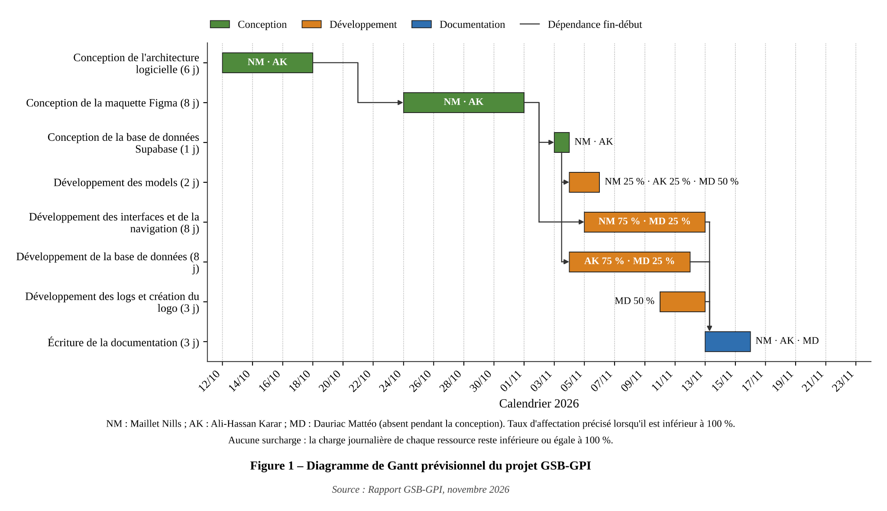

**Figure 1 : Diagramme de Gantt prévisionnel du projet GSB-GPI**  
*Source : Rapport GSB-GPI, novembre 2026*

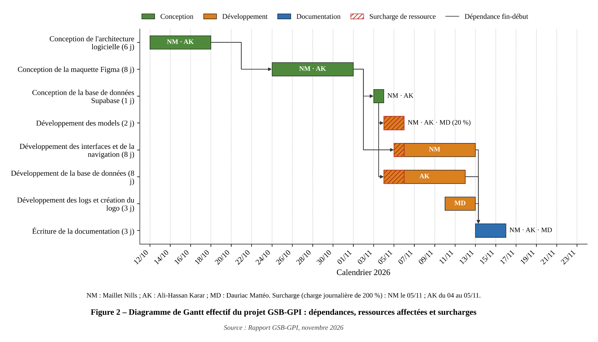

**Figure 2 : Diagramme de Gantt effectif du projet GSB-GPI : dépendances, ressources affectées et surcharges**  
*Source : Rapport GSB-GPI, novembre 2026*

#### Enchaînement des phases et dépendances entre les tâches

Les tâches s’enchaînent selon une logique simple : une tâche ne commence qu’une fois la précédente terminée. L’architecture logicielle ouvre le projet et prépare la maquette Figma. La maquette sert ensuite de base à la conception de la base de données et au développement des interfaces. La base de données conçue permet de développer les models et la base elle-même. Enfin, la documentation ne démarre qu’une fois le développement achevé.

La conception est donc entièrement séquentielle. Au début du développement, en revanche, plusieurs tâches se déroulent en parallèle : les models, la base de données et les interfaces. Ce parallélisme raccourcit la durée du projet, mais il est à l’origine des surcharges abordées plus loin.

#### Répartition de l'effort et des ressources

L’effort est réparti de façon équilibrée entre le chef de projet et Ali Hassan Karar, qui portent l’essentiel du travail : ils mènent ensemble la conception, puis chacun prend en charge une grande tâche de développement. Dauriac Mattéo, absent pendant la conception, intervient surtout sur le développement et la documentation, avec une charge plus légère. Du côté des tâches, la phase de développement est la plus fournie, la conception vient ensuite, et la documentation ne compte qu’une seule tâche.

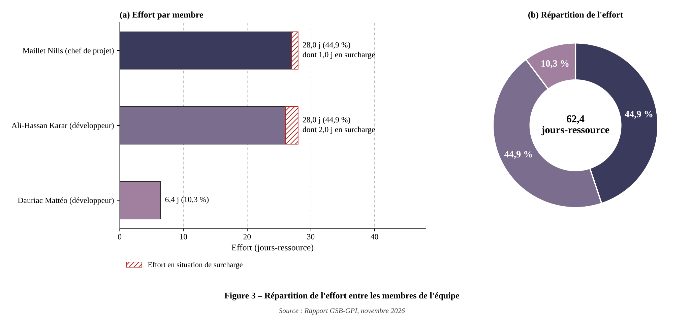

**Figure 3 : Répartition de l’effort entre les membres de l’équipe**  
*Source : Rapport GSB-GPI, novembre 2026*

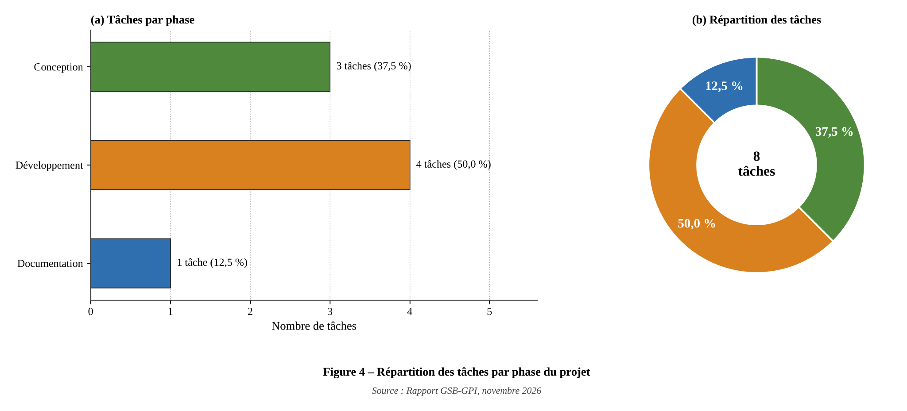

**Figure 4 : Répartition des tâches par phase du projet**  
*Source : Rapport GSB-GPI, novembre 2026*

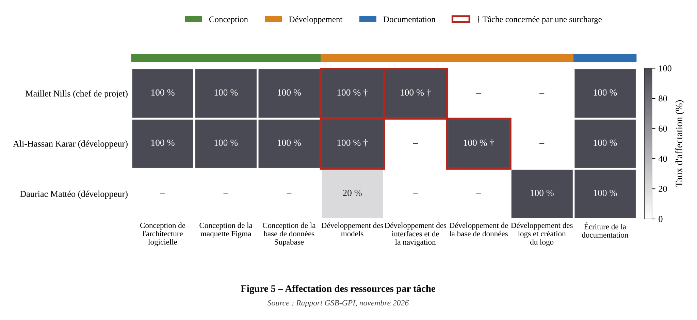

**Figure 5 : Affectation des ressources par tâche**  
*Source : Rapport GSB-GPI, novembre 2026*

Le planning prévisionnel répartit le travail différemment. Dauriac Mattéo assiste les deux autres membres sur les tâches de développement : 50 % sur les models, 25 % sur les interfaces et 25 % sur la base de données. L’effort devient alors de 24,5 jours-ressource pour chacun des deux premiers membres et de 9,5 pour Dauriac Mattéo, soit 58,5 jours au total. Le chef de projet et Ali Hassan Karar gardent l’essentiel de la conception, où Mattéo, absent, ne peut pas intervenir. Ce total plus faible suppose que les durées restent identiques.

#### Charge de travail et gestion des surcharges

Dans le planning effectif, la charge de chaque membre est comparée à sa capacité journalière. Deux surcharges apparaissent, au début du développement, là où les tâches se chevauchent. Le chef de projet et Ali Hassan Karar se retrouvent chacun, pendant un à deux jours, à mener deux tâches de front. Ces surcharges ne traduisent pas un retard : elles résultent du chevauchement prévu des tâches.

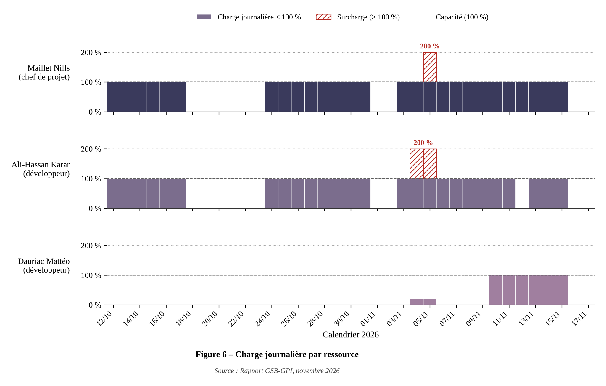

**Figure 6 : Charge journalière par ressource**  
*Source : Rapport GSB-GPI, novembre 2026*

Le planning prévisionnel les évite sans changer aucune date. Le chef de projet et Ali Hassan Karar réduisent leur part sur les models, puis partagent les interfaces et la navigation et la base de données avec Dauriac Mattéo. Pour que ce dernier ne soit pas surchargé à son tour, la charge de ses logs était allégée.

---

## Phase de conception

### Objectifs et livrables de la phase

Cette phase constitue un élément crucial du développement de notre application. En effet, elle constitue le pont entre l’analyse des besoins et la phase de développement technique. Ainsi, son objectif a été de traduire les besoins énumérés en structures et moyens techniques. C’est durant cette phase que nous avons étudié les différentes solutions techniques à adopter.

Celle-ci s’est concrétisé autour de 3 livrables principaux :

- Modélisation des données par un schéma de type MCD et MLD (annexe à insérer?) afin de formaliser et structurer la future Base de données qui alimentera et stockera l’ensemble des données de l’application.
- L’Architecture logicielle qui s’articulera avec une organisation de code de pattern MVVM afin d’assurer une organisation net et séparé entre l’interface utilisateur, la logique et l’accès aux données. Accompagné de cela, nous avons décidé de créer une classe static `DbToolBox` pour contenir l’ensemble des méthodes en interaction avec SupaBase.
- Initialisation de l’interface graphique via l’outil de design collaboratif Figma.

### Conception de l'architecture logicielle

L'architecture logicielle de l'application repose sur le pattern MVVM (Model-View-ViewModel). Ce choix garantit un code plus clair, modulaire et maintenable en séparant strictement l'interface utilisateur (les Views), la logique applicative (les ViewModels) et la structure des données (les Models).

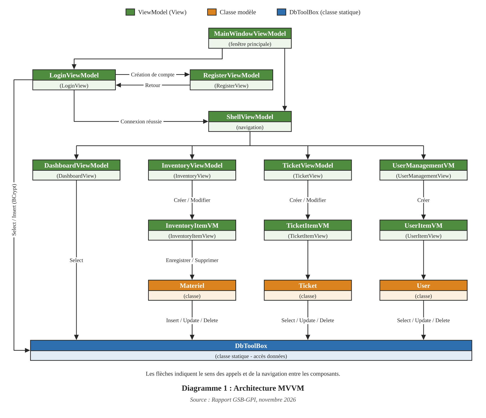

**Diagramme 1 : Architecture MVVM**  
*Source : Rapport GSB-GPI, novembre 2026*

En ce qui concerne les Models, un diagramme des classes a été réalisé en amont du développement. Cette modélisation à permit de définir les attributs, les types de données et les héritages entre elles. Cette étape a grandement contribué à la structuration des Models de manière claire mais aussi d’anticiper leur future liaison avec Entity Framework Core, dans le but de communiquer avec la base de données.

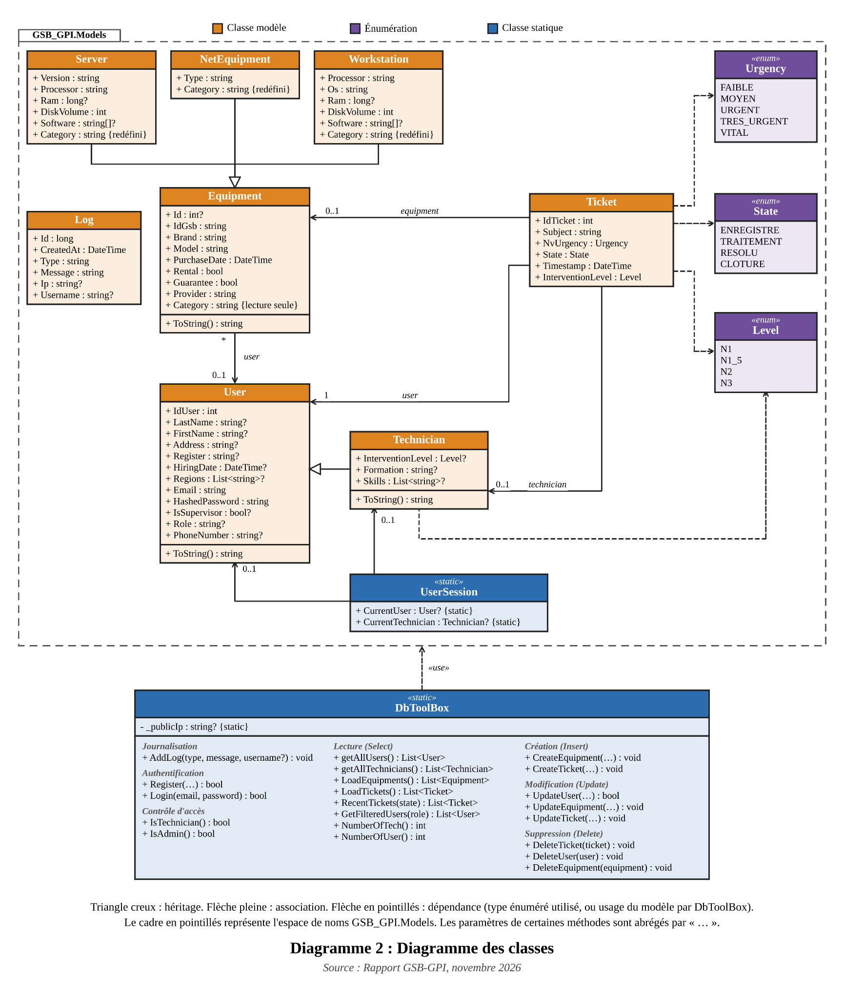

**Diagramme 2 : Diagramme des classes**  
*Source : Rapport GSB-GPI, novembre 2026*

Pour la communication avec la base de données hébergée sur Supabase, nous avons intégré Entity Framework Core. Cet ORM (*Object-Relational Mapping*) permet de traduire des requêtes LINQ en instructions PostgreSQL de manière sécurisée et optimisée, tout en offrant une excellente lisibilité du code. Mais aussi, de gérer de manière automatique les héritages ce qui en fait de lui un outil particulièrement efficace. Enfin, l'ensemble des interactions avec la base de données a été centralisé au sein d'une classe statique dédiée, nommée `DbToolBox`. Cette structuration allège considérablement les ViewModels, simplifie la maintenance et facilite grandement la résolution des bugs.

### Conception de la maquette Figma

Pour concevoir les interfaces via Avalonia, nous avons dans un premier temps réalisé toutes les interfaces sur Figma. Par son aspect collaboratif, nous avons pu s’entraider et communiquer sur les missions à faire et les améliorations à réaliser en temps réel. Grâce à cela, nous avons pu gérer et harmoniser l’ensemble des vues (`LoginView`, `RegisterView`, `DashboardView`, `InventoryView`, etc.).

A travers sa fonctionnalité prototype, la visualisation de la navigation a été particulièrement pratique. Cela nous a permis d’anticiper et d’optimiser au mieux l’expérience utilisateur. De plus, la palette de variables intégré à cet outil nous a permis d’harmoniser l’ensemble du design couleur de l’application.

*Exemple d’un maquette réalisé (`LoginView`) :*

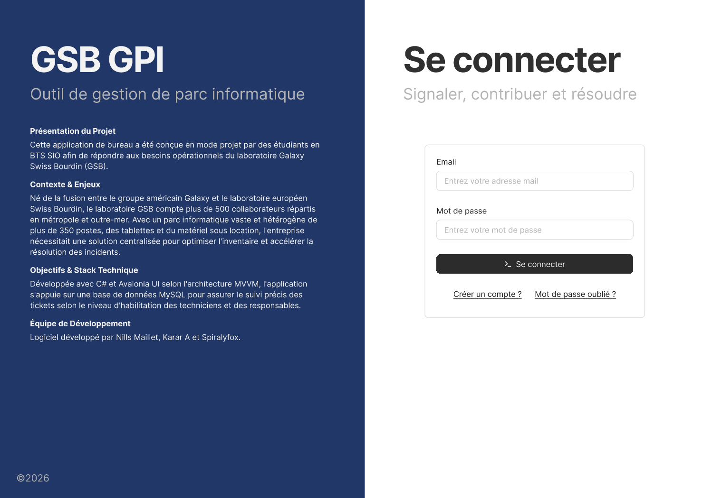

### Conception de la base de données Supabase

Pour assurer le stockage des données de l’application, celle-ci s’appuie sur une base de données hébergée sur Supa Base (PostgreSQL). La première étape de sa conception à été de traduire l’ensemble des exigences par l’élaboration d’un MCD, permettant d’identifier les entités principales du projet tels que les utilisateurs, equipements et tickets ainsi que leurs associations.

*Modèle Conceptuel et Logique de la Base de données :*

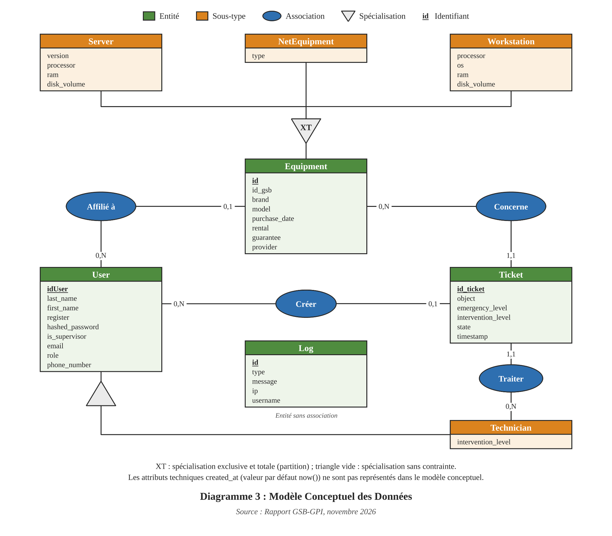

**Diagramme 3 : Modèle Conceptuel des Données**  
*Source : Rapport GSB-GPI, novembre 2026*

Ce modèle a ensuite donné lieu à un MLD qui formalise les tables et surtout les clés primaires et clés étrangères. Mais aussi, celui-ci nous a permis d’avoir une idée plus claire et précise sur la structuration de nos Models ainsi que notre manière d'interagir avec la Base de données.

Enfin, grâce à l’utilisation de l’EF Core combiné à la classe `DbToolBox`, l’ensemble des requêtes LINQ sont exécutés de manière centralisée et sécurisée.

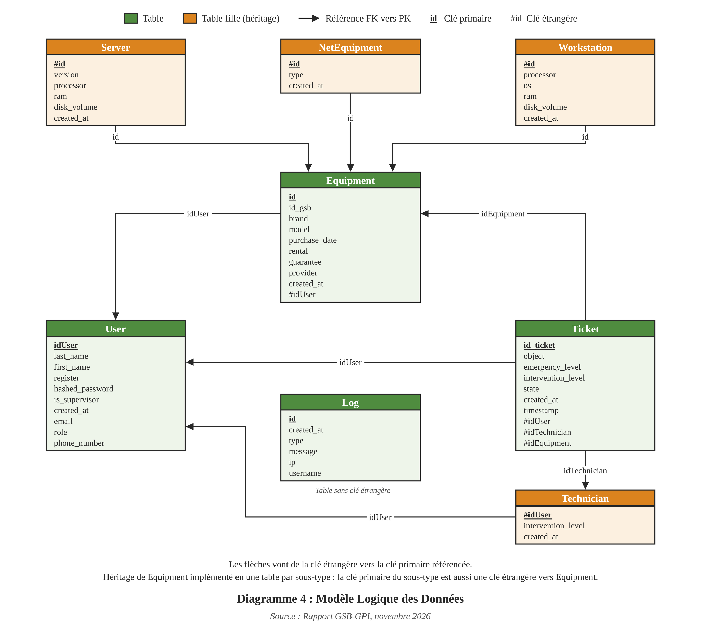

**Diagramme 4 : Modèle Logique des Données**  
*Source : Rapport GSB-GPI, novembre 2026*

### Bilan de la phase de conception

En somme, la phase de conception a permis de poser un cadre clair et structuré pour le développement de l’application GSB-GPI. En traduisant les besoins en réponses techniques rigoureuses, cette étape a considérablement réduit les risques d’erreurs et de non conformité aux demandes établies.

En premier lieu, le pattern MVVM et une centralisation des requêtes avec la Base de données via la classe `DbToolBox` ont garanti à l’application un code propre et facile à maintenir.

En deuxième lieu, la conception du MCD & MLD couplé avec l'utilisation de l’EF Core pour assurer la communication avec la Base de données Supabase ont permis d’assurer la persistance sécurisé de l’ensemble des données de GSB-GPI.

Enfin, l’utilisation de Figma a offert une vision claire et anticipée des différentes interfaces et leur ergonomie. Tout en facilitant l'harmonisation et la conception de l'ensemble du design.

---

## Phase de développement

### Objectifs et livrables de la phase

La phase de développement a concrétisé la phase de conception expliquée précédemment dans l’objectif de transformer le tout en une application pleinement opérationnelle. Cela passe par le fait d'obtenir une interface propre et fonctionnelle, un code source structuré et une connexion opérationnelle avec la Base de données. Ainsi, l’atteinte de ces différents objectifs s’est concrétisé par les livrables suivants :

- Une concrétisation visuelle technique par la mise en place d’une navigation fluide et logique entre les différentes View codées avec Avalonia à partir de la maquette établi sur Figma.
- Une connexion établie avec la Base de données à l’aide de méthodes LINQ contenu dans la classe `DbToolBox` permettant l’extraction et l’interaction avec les données contenues dans celle-ci. Ces méthodes sont couplées avec l’EntityFramework Core qui est chargé d’assurer la connexion et l’envoie de ces requêtes à la Base de données.
- Etablissement du Code source à travers le développement des différents Models et les ViewModels.

### Développement des models

La conception concrète de l’ensemble des Models constitue la fondation de toute notre application. Elles servent de pont direct entre la Base de données et le code C# en lui-même.

Pour assurer cette liaison de manière fonctionnel, nous avons transposée chaque table de notre BD en classe C# structurée. En plus de cela, pour que l’ORM puisse permettre de communiquer entre ces Models et la Base de données nous avons associé chaque Table de la BD à une classe et chaque Colonne de cette table à un attribut de la classe.

Enfin , ces Models ont permis la circulation des données dans toute l'architecture MVVM en plus de la circulation avec la BD.

```csharp
[Table("Equipment")]
public class Equipment
{
    [Key]
    [Column("id")]
    public int? Id { get; set; }

    [Column("id_gsb")]
    public string IdGsb { get; set; }

    ...
}
```

**Code 1 : Structuration des Models en intégrant l’EF Core**  
*Source : Code Source de GSB-GPI, novembre 2026*

### Développement de la base de données

#### Mise en place de la base de données

Concernant la phase de développement, elle a principalement consisté à concrétiser les choix établis lors de la conception du MCD & MLD en un environnement opérationnel. La première étape a été de construire cette Base de données sur Supabase en respectant tout ce qu’on a établie lors de la conception. Cela passe par la construction de l’ensemble des tables et leur contenu.

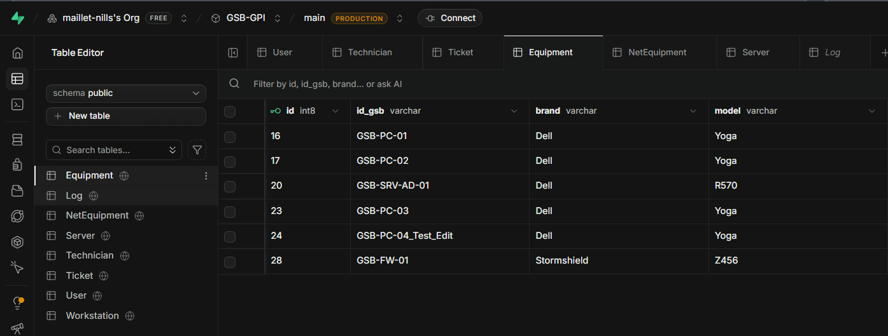

**Capture 1 : Structuration des Tables dans la BD Supabase**  
*Source : Base de données GSB-GPI, novembre 2026*

À la suite de cela, nous nous sommes occupés de relier l'application GSB-GPI à la base de données via Entity Framework Core. Pour ce faire, nous avons configuré la classe `GsbGPIDbContext` (qui hérite directement de `DbContext` de l’EF Core qui permettra l’utilisation du LINQ avec la BD). Celle-ci gère la connexion à l'aide d'une chaîne de connexion (*connection string*) au sein de la méthode `OnConfiguring`, ainsi que le paramétrage des spécificités et des contraintes d'intégrité lors de l'insertion des données au sein de la méthode `OnModelCreating`.

```csharp
public class GsbGPIDbContext : DbContext
{
    public DbSet<Equipment> Equipments { get; set; }
    public DbSet<User> Users { get; set; }
    public DbSet<Technician> Technicians { get; set; }
    public DbSet<Ticket> Tickets { get; set; }
    public DbSet<Log> Logs { get; set; }
    //Ces DbSet servent de passerelle avec Entity Framework pour représenter les tables de la base de données distante sous forme de collections C#, permettant ainsi d'effectuer des requêtes LINQ (les modifications sont synchronisées en direct avec la base).

    protected override void OnConfiguring(DbContextOptionsBuilder optionsBuilder)
    {
        string connectionstring = "Host=...;Database=...;Username=...;Password=...; ";
        optionsBuilder.UseNpgsql(connectionstring);
    }

    protected override void OnModelCreating(ModelBuilder modelBuilder)
    {
        base.OnModelCreating(modelBuilder);
        //Exemple de spécificité pouvant être inclus dans la méthode OnModelCreating (ici elle convertit un attribut en string avant l'insertion)
        modelBuilder.Entity<Technician>()
            .Property(t => t.InterventionLevel)
            .HasConversion<string>();
    }
}
```

**Code 2 : Structuration des Models en intégrant l’EF Core**  
*Source : Code Source de GSB-GPI, novembre 2026*

#### Méthodes de la base de données

Enfin, pour interagir avec la BD, il nous a fallu créer des méthodes permettant la sélection, l’insertion, la suppression des données entre autres. Dans ce but, nous avons conservé ces méthodes dans une classe static `DbToolBox` qui se connectera à la Base de données Supabase afin d'interagir avec celle-ci par ses méthodes. Pour rappel, cette connexion est gérée par la méthode `OnConfiguring` du fichier `GsbGPIDbContext`.

Pour y voir plus clair, voici quelques exemples de méthodes (plus précisément les 4 Interaction principales : Sélection, Suppression, Ajout et Modification) de la `DbToolBox` permettant la connexion, la suppression de ticket :

```csharp
public static bool Login(string email, string password)
{
    //1°
    using (var context = new GsbGPIDbContext())
    {
        //2°
        var user = context.Users.FirstOrDefault(u => u.Email == email);
        //Recherche de l'utilisateur pour savoir s’il existe par une requête LINQ par son email <=> SELECT en SQL

        //3°
        if (user == null)
        {
            AddLog(...);
            return false;
        }

        //4°
        bool isPasswordValid = BCrypt.Net.BCrypt.Verify(password, user.HashedPassword);
        //Méthode intégré à Bcrypt permettant de faire la comparaison avec le MDP du user (Haché par mesure de sécurité)

        if (isPasswordValid)
        {
            AddLog(...);
            UserSession.CurrentUser = user;
        }
        else
        {
            AddLog(...);
        }

        return isPasswordValid;
    }
}
```

**Code 3 : Structuration de la Méthode Login() de la DbToolBox**  
⇔ `SELECT WHERE` (Sélection)  
*Source : Code Source de GSB-GPI, novembre 2026*

**Explication :**

- **1°** Le `using (var context = new GsbGPIDbContext())` va ouvrir une connexion temporaire avec la BD à travers la classe `GsbGPIDbContext`
- **2°** La requête LINQ `FirstOrDefault` va permettre de parcourir la représentation de la table User et cherché un user avec le même email que dans le paramètre et s'arrêter et s’il ne trouve rien il renvoie `null`.
- **3°** Si cela échoue la méthode renverra `false`.
- **4°** S’il existe et que la comparaison des MDP du paramètre et du User `BCrypt.Net.BCrypt.Verify` sont vrai alors la méthode renverra `true` → Connexion Réussi.

En termes SQL, c’est le `SELECT WHERE` qui a été employé.

```csharp
public static void DeleteTicket(Ticket SelectedTicket)
{
    //1°
    using (var db = new GsbGPIDbContext())
    {
        //2°
        db.Tickets.Remove(SelectedTicket);
        db.SaveChanges();
        //Supprime le ticket passé en paramètre de la BD puis sauvegarde les changements à travers du LINQ <=> DELETE en SQL
        AddLog(...);
    }
}
```

**Code 4 : Structuration de la Méthode DeleteTicket() de la DbToolBox**  
⇔ `DELETE…WHERE` (Supression)  
*Source : Code Source de GSB-GPI, novembre 2026*

**Explication :**

- **1°** Voir 1° du Code 3.
- **2°** La requête LINQ `Remove` va permettre de supprimer le ticket assigné dans la représentation de la table `Tickets`, une fois cela fait les modifications sont enregistrées à travers `SavesChanges`.

En termes SQL, c’est le `DELETE… WHERE` qui a été employé.

```csharp
public static void CreateTicket(string subject, User user, Technician? technician, Urgency urgency, State state, Level level, Equipment? equipment)
{
    //1°
    using (var db = new GsbGPIDbContext())
    {
        //2°
        var existingUser = db.Users.Find((user?.IdUser));
        var existingTechnician = technician == null ? null : db.Technicians.Find(technician.IdUser);
        var existingEquipment = equipment == null ? null : db.Equipments.Find(equipment.Id);

        if (existingUser == null)
        {
            AddLog(...);
            return;
        }

        //3°
        var ticket = new Ticket
        {
            Subject = subject,
            User = existingUser,
            Technician = existingTechnician,
            NvUrgency = urgency,
            State = state,
            InterventionLevel = level,
            Timestamp = DateTime.UtcNow,
            Equipment = existingEquipment,
        };

        //4°
        db.Tickets.Add(ticket);
        db.SaveChanges();
        AddLog(...);

        if (existingTechnician != null)
        {
            AddLog(...);
        }
    }
}
```

**Code 5 : Structuration de la Méthode CreateTicket() de la DbToolBox**  
⇔ `INSERT INTO` & `SELECT…WHERE` (Création)  
*Source : Code Source de GSB-GPI, novembre 2026*

**Explication :**

- **1°** Voir 1° du Code 3.
- **2°** Les requête LINQ `Find` vont permettre de parcourir la représentation des tables `User`, `Technicians` et `Equipments` et de chercher un objet de la table respectif avec le même Id que dans le paramètre. Dans le cas où un `User` n’est pas trouvé, la méthode est arrêtée.
- **3°** Si le `User` existe alors un objet `Ticket` sera créé avec les paramètres assigné.
- **4°** Le `Ticket` sera créé dans la table `Tickets` par la requête LINQ `Add` et ensuite sauvegarder ces changements avec `SavesChanges`.

En termes SQL, c’est le `SELECT… WHERE` et le `INSERT INTO` qui ont été employés.

```csharp
public static bool UpdateUser(User SelectedUser, string LastName, string FirstName, string Email, string Password, string SelectedRole, string Phonenumber, string Registernumber)
{
    //1°
    using (var context = new GsbGPIDbContext())
    {
        //2°
        var userTarget = context.Users.FirstOrDefault(e => e.IdUser == SelectedUser.IdUser);
        if (userTarget == null)
        {
            Console.WriteLine("Tentative de modification échoué.");
            return false;
        }

        //3°
        userTarget.LastName = LastName;
        userTarget.FirstName = FirstName;
        userTarget.Email = Email;
        userTarget.Role = SelectedRole;
        userTarget.PhoneNumber = Phonenumber;
        userTarget.Register = Registernumber;
        if (!string.IsNullOrWhiteSpace(Password))
        {
            userTarget.HashedPassword = BCrypt.Net.BCrypt.HashPassword(Password);
        }

        //4°
        context.SaveChanges();
        return true;
    }
}
```

**Code 6 : Structuration de la Méthode CreateTicket() de la DbToolBox**  
⇔ `SELECT… WHERE` & `UPDATE… SET… WHERE…`  
*Source : Code Source de GSB-GPI, novembre 2026*

**Explication :**

- **1°** Voir 1° du Code 3.
- **2°** La requête LINQ `FirstOrDefault` va permettre de parcourir la représentation de la table `User` et chercher un user avec le même `IdUser` que dans le `SelectedUser` dans les paramètres et s'arrêter et s’il ne trouve rien il renvoie `null`.
- **3°** Si le `SelectedUser` existe alors l’objet `SelectedUser` subira des modifications et aura comme nouvelles caractéristiques la valeurs des variables en paramètre.
- **4°** Le `SelectedUser` sera donc modifié et sauvegarder par la requête LINQ `SavesChanges`.

En termes SQL, c’est le `SELECT… WHERE` et le `UPDATE… SET… WHERE…` qui ont été employés.

À travers ces quatre exemples clés, le fonctionnement global et les mécanismes fondamentaux de la `DbToolBox` se trouvent exposés. Qu'il s'agisse de requêtes, de mises à jour ou de transactions, l'ensemble des interactions avec la base de données s'articule systématiquement autour de ces grands principes.

### Développement des interfaces et de la navigation

La réalisation des interfaces graphiques repose sur le framework Avalonia UI, dont la structure des vues (Views) s'appuie sur des fichiers au format `.axaml`. Ce format fonctionne sous forme de balises hiérarchisées (panneaux de disposition et contrôles visuels), permettant de concevoir les fenêtres de manière modulaire.

Dans le respect strict du patron de conception MVVM, l'interaction entre la vue et son modèle de vue (ViewModel) repose entièrement sur le mécanisme des bindings (liaisons de données). Les traditionnels événements de clic impératifs sont ainsi remplacés par des commandes, grâce à l'utilisation de `RelayCommand` mis à disposition par le CommunityToolkit.Mvvm. Lorsqu'un utilisateur interagit avec un composant graphique, l'action est directement transmise et traitée par la méthode correspondante dans le ViewModel.

Voici par exemple un cas d'usage pour la méthode de suppression d'un ticket existant, avec d'un côté le code C# et de l'autre, le Axaml.

```csharp
[RelayCommand]
private void Delete()
{
    DbToolBox.DeleteTicket(_ticketToEdit);
    Closed?.Invoke();
}
```

**Code 3 : Méthode Delete() de TicketItemViewModel.cs**  
*Source : Code Source de GSB-GPI, novembre 2026*

```xml
<Button Classes="delete" Content="Supprimer" Command="{Binding DeleteCommand}" Padding="16,6"/>
```

**Code 4 : Balise button avec binding DeleteCommand de TicketItemView.axaml**  
*Source : Code Source de GSB-GPI, novembre 2026*

### Développement des logs et création du logo

La mise en place d’un système de Logs est indispensable pour assurer la traçabilité et la bonne maintenance de l’application. Ainsi, cela facilite le travail de débogage. Cela s’articule par l’enregistrement des actions critiques ou des actions utilisateur tels que la connexion, modification de données, etc. Ces logs ont été codés à travers une méthode `AddLog` contenue dans la classe `DbToolBox` qui est elle-même rattachée à une table logs dans Supabase ou ils seront stockés.

```csharp
public static void AddLog(string type, string message, string? username = null)
{
    using (var context = new GsbGPIDbContext())
    {
        if (_publicIp == null)
        {
            try
            {
                using (var http = new HttpClient())
                {
                    http.Timeout = TimeSpan.FromSeconds(3);
                    _publicIp = http.GetStringAsync("https://api.ipify.org").GetAwaiter().GetResult().Trim();
                }
            }
            catch (Exception)
            {
                _publicIp = null;
            }
        }

        if (username == null && UserSession.CurrentUser != null)
        {
            username = $"{UserSession.CurrentUser.FirstName} {UserSession.CurrentUser.LastName}";
        }

        var newLog = new Log(type, message, _publicIp, username);
        context.Logs.Add(newLog);
        context.SaveChanges();
    }
}
```

**Code 5 : Structuration de la Méthode AddLog()**  
*Source : Code Source de GSB-GPI, novembre 2026*

En parallèle, nous avions décidé de créer un logo via Canva afin de l’implémenter dans notre application tout en respectant le code couleur de GSB-GPI. Celui-ci sera utilisé comme icône lors de l'exécution de l’application ainsi que comme icône de bureau pour sa version .exe. Ce choix est motivé par une volonté de logique et de finalisation esthétique de l’application.

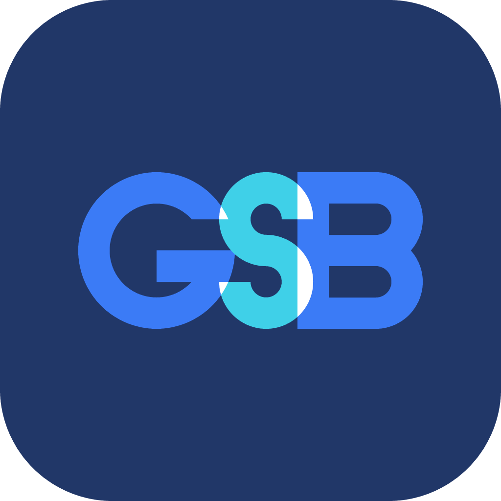

**Capture 2 : Logo de GSB-GPI**  
*Source : Base de données GSB-GPI, novembre 2026*

### Bilan de la phase de développement

La phase de développement a ainsi permis de concrétiser l’ensemble des choix de conception formalisés durant la phase précédente. Cette phase a permis de développer de manière réussie l’application GSB-GPI.

Cette réussite s’illustre par l’atteinte des objectifs techniques fixés, principalement par l’adoption de manière rigoureuse du pattern MVVM permettant un fonctionnement et une navigation optimale et claire de l’application.

Mais aussi, par l’implémentation d’EF Core qui a rendu le fonctionnement de l’application clair à travers ses méthodes LINQ contenues dans la `DbToolBox` en liaison avec la BD Supabase. En plus de son efficacité, l’ORM nous a permis de remédier à un problème récurrent qui est l’injection SQL. Ainsi, il est à la fois efficace mais aussi sécuritaire.

Enfin, elle s’articule notamment par l’attention particulière accordée au design et à la forme globale de l’application reflétant une démarche de qualité et une volonté à ce que l’utilisateur passe une expérience agréable.

---

## Phase de documentation

### Objectifs et public visé

La phase de documentation constitue l'étape finale du projet GSB-GPI. Son objectif principal est de produire un rapport exhaustif retraçant l'ensemble de la démarche menée, depuis l'analyse initiale des besoins et la gestion de projet jusqu'aux choix de conception, à la réalisation technique et au bilan critique. Ce document formalise le travail accompli et atteste de l'atteinte des objectifs fixés par le cahier des charges du laboratoire Galaxy Swiss Bourdin.

Sur le plan du public visé, ce rapport s'adresse en premier lieu à l'équipe pédagogique et aux membres du jury du BTS SIO, qui sont chargés d'évaluer la qualité de la réalisation, la pertinence des choix technologiques et la maîtrise des compétences professionnelles de l'option SLAM. Par ailleurs, cette documentation constitue une ressource technique et fonctionnelle pérenne, utile à tout administrateur ou développeur qui serait amené à reprendre, maintenir ou faire évoluer l'application GSB-GPI à l'avenir.

### Écriture de la documentation

La rédaction de ce rapport s'est appuyée sur l'ensemble des artéfacts et des documents de suivi produits tout au long du cycle de vie du projet. La partie dédiée à la gestion de projet et à l'organisation du travail a ainsi été construite à partir du suivi réalisé sous l'espace de travail Notion et des diagrammes prévisionnels et effectifs sous GanttProject, permettant de situer chaque tâche dans le temps et d'analyser fidèlement la répartition des charges.

Pour illustrer et expliciter les aspects techniques, la rédaction s'est appuyée sur les livrables validés lors de la phase de conception. Les schémas d'architecture logicielle, les maquettes d'interface graphiques sous Figma, ainsi que les modèles conceptuels et logiques de données ont été intégrés directement dans le corps du texte pour appuyer les explications. Cette mise en cohérence entre les documents de conception, les captures de l'application finale et le code source versionné sur GitHub garantit la transparence et la traçabilité de l'ensemble du travail de développement réalisé.

### Compilation du projet

Afin de déployer l'application GSB-GPI sur les postes clients du laboratoire sans nécessiter l'installation de l'environnement de développement ni du SDK .NET, il est nécessaire de compiler le projet en un exécutable autonome (*self-contained*). Cette opération s'effectue directement depuis l'IDE JetBrains Rider à l'aide de l'outil de publication intégré.

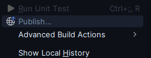 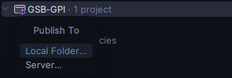

Dans un premier temps, il convient d'ouvrir la solution GSB-GPI dans Rider et de vérifier que la configuration de génération active dans la barre d'outils supérieure est bien basculée de Debug vers Release, afin d'optimiser les performances de l'application finale. Une fois la solution prête, un clic droit sur le projet principal dans l'explorateur de solutions permet d'accéder au menu contextuel et de sélectionner l'option Publish (Publier), puis Publish to Folder (Publier dans un dossier).

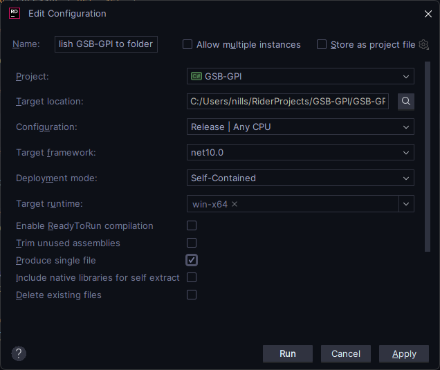

Une fois les paramètres validés en cliquant sur le bouton Run (Exécuter), Rider lance la compilation et l'assemblage des ressources. Le suivi de l'opération s'affiche dans la console de sortie en bas de l'interface jusqu'à l'apparition du message confirmant le succès de la publication. Il ne reste plus qu'à ouvrir le dossier de destination configuré précédemment pour récupérer le fichier `GSB-GPI.exe`, prêt à être distribué et exécuté directement sur les postes clients.

### Documentation utilisateur

#### Authentification et gestion du compte

L'accès à l'application GSB-GPI est sécurisé et nécessite une authentification préalable afin d'identifier l'utilisateur et de lui attribuer les droits correspondant à son profil. Lors du premier lancement, l'utilisateur est accueilli sur l'écran de connexion.

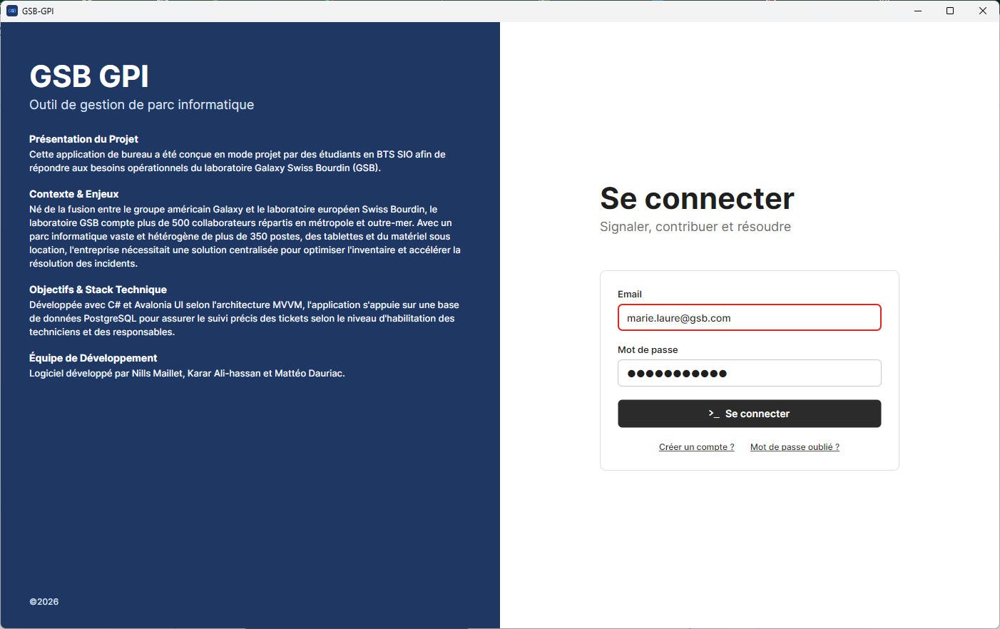

S'il ne possède pas encore de compte, il peut basculer vers le formulaire d'inscription pour enregistrer ses informations personnelles (nom, prénom, adresse électronique, numéro de téléphone et mot de passe). Une fois le compte créé, la saisie de ses identifiants permet d'accéder à l'espace de travail principal.

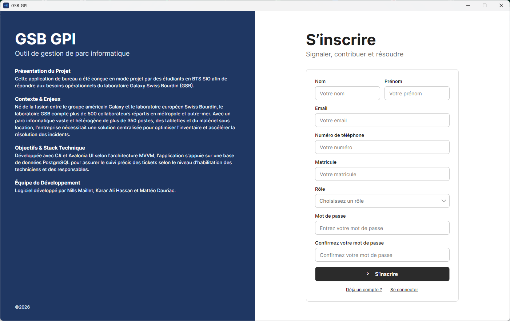

#### Navigation et espace de travail selon le profil

Une fois connecté, l'utilisateur accède à l'interface principale structurée autour d'un menu de navigation latéral et d'un tableau de bord central. Ce tableau de bord offre une vue synthétique de l'activité, regroupant notamment l'état général du parc informatique et le suivi des tickets récents.

Le menu de navigation s'adapte automatiquement au niveau d'habilitation du compte connecté :

- **Un utilisateur simple** est redirigé directement vers l'espace de gestion de ses tickets, le tableau de bord étant réservé aux équipes techniques et d'encadrement. Il peut uniquement déclarer de nouveaux incidents et consulter l'état d'avancement de ses propres demandes.
- **Un technicien** accède au tableau de bord synthétisant l'activité du parc et du support, à l'ensemble des tickets déclarés pour les traiter, ainsi qu'au module d'inventaire du matériel.
- **Un responsable** bénéficie de la totalité des fonctionnalités, incluant en plus l'administration des comptes utilisateurs et la gestion des rôles.

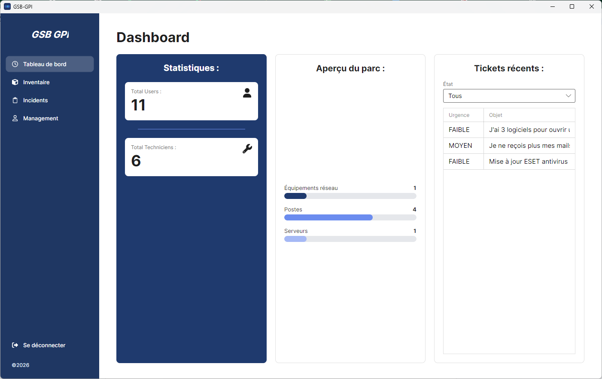

#### Déclaration et suivi d'un incident (Tous profils)

Le module de gestion des tickets centralise les demandes d'assistance informatique au sein de l'entreprise. Pour signaler un dysfonctionnement, le collaborateur se rend dans la rubrique des tickets et déclenche la création d'une nouvelle demande. Il doit alors renseigner l'objet de l'incident, sélectionner l'équipement concerné parmi ceux qui lui sont affiliés, préciser le degré d'urgence et décrire le problème rencontré. Une fois validé, le ticket apparaît dans sa liste de suivi avec un état initial permettant d'en observer l'avancement en temps réel.

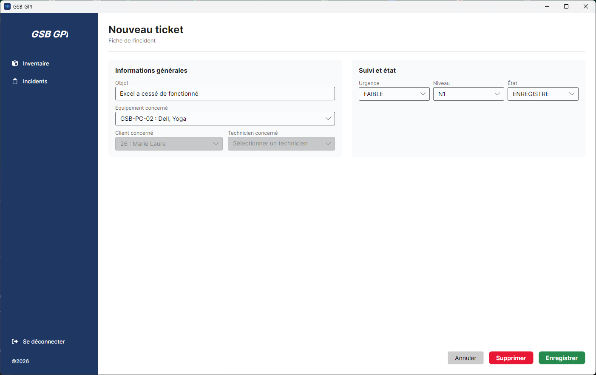

#### Traitement des incidents (Techniciens et Responsable)

Les membres de l'équipe support disposent d'outils dédiés pour prendre en charge et résoudre les incidents déclarés par les collaborateurs.

Depuis la liste globale des tickets, le technicien peut consulter l'ensemble des demandes en attente, s'assigner un ticket et ajuster son niveau d'intervention si nécessaire. Au fur et à mesure de son diagnostic et de ses actions correctives, il met à jour l'état du ticket (par exemple en cours de traitement, puis résolu ou clôturé). Côté client, celui-ci ne voit que les tickets le concernant.

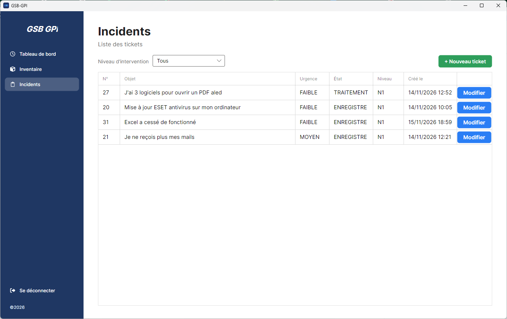

#### Gestion de l'inventaire du matériel (Techniciens et Responsables)

Le module d'inventaire permet de maintenir à jour le référentiel de l'ensemble des équipements informatiques du laboratoire. L'interface présente la liste détaillée du matériel enregistré (postes de travail, serveurs et équipements réseau). Côté client, celui-ci ne voit que le matériel lui état attribué.

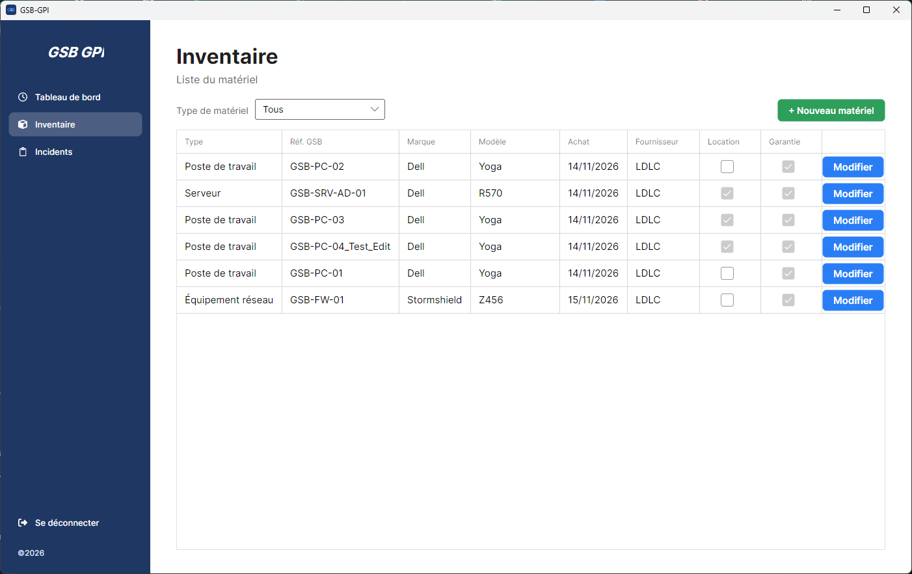

L'opérateur peut ajouter un nouvel équipement en précisant sa catégorie, son identifiant interne GSB, sa marque, son modèle, sa date d'achat, son fournisseur ainsi que ses éventuelles conditions de location ou de garantie. Selon le type de matériel choisi, des caractéristiques techniques spécifiques sont demandées (processeur, mémoire vive, volume disque ou système d'exploitation). Ce module permet également d'affilier un équipement à un utilisateur précis, de modifier sa fiche ou de le retirer du parc.

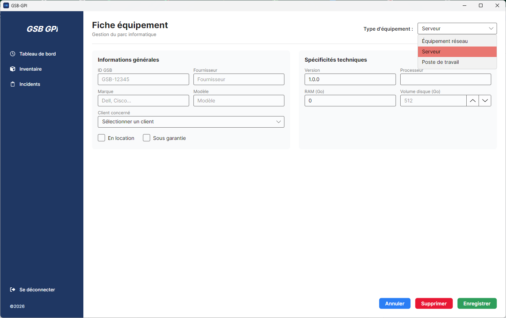

#### Administration des utilisateurs (Responsable uniquement)

La gestion des comptes permet de contrôler les accès à l'application et d'organiser les équipes techniques. Depuis l'espace d'administration des utilisateurs, le responsable visualise l'annuaire des comptes enregistré et les trier en fonction de leur rôle.

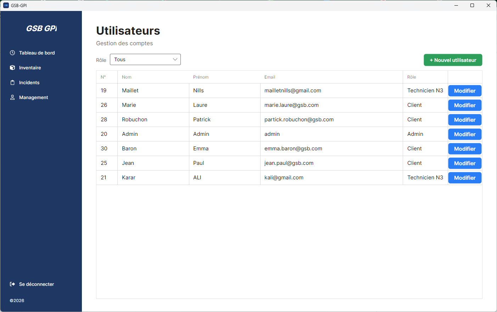

Le responsable peut aussi créer un nouvel utilisateur, modifier ses coordonnées, promouvoir un collaborateur au rang de technicien en définissant son niveau d'intervention, attribuer les droits de supervision ou supprimer un compte obsolète.

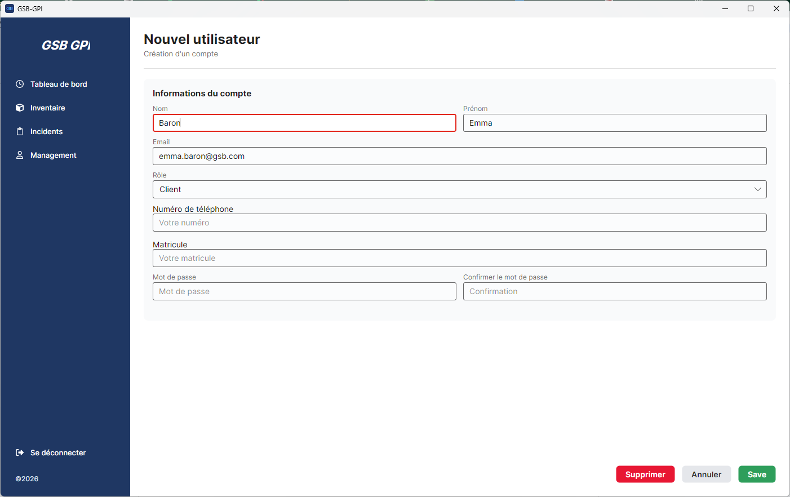

### Bilan de la phase de documentation

La phase de documentation a représenté l'ultime étape du projet, mobilisant simultanément les trois membres de l'équipe sur une période condensée de trois jours en fin de planning. Cette contrainte temporelle a constitué le principal défi de cette étape, exigeant une organisation rigoureuse pour synthétiser l'ensemble des travaux réalisés tout en respectant l'échéance finale. Pour relever ce défi, l'équipe a dû répartir efficacement la rédaction entre les différents volets du rapport (gestion de projet, documentation technique et manuel utilisateur) afin d'avancer en parallèle sans perdre en cohérence.

Au-delà de la gestion du temps, un travail important d'harmonisation a été nécessaire pour garantir une correspondance exacte entre les schémas produits lors de la conception, les captures d'écran de l'interface finale et l'implémentation réelle du code source. Il a également fallu veiller à uniformiser le style rédactionnel et la mise en forme des contributions de chacun afin d'aboutir à un document fluide, structuré et adapté aussi bien à l'évaluation par le jury qu'à une éventuelle reprise du projet. Malgré son intensité, cette phase a permis de prendre du recul sur l'application livrée et de valoriser la cohérence globale de notre démarche.

---

## Conclusion

### Bilan général du projet

#### Objectifs atteints

Au terme des cinq semaines de développement, l'application GSB-GPI répond pleinement au cahier des charges établi pour répondre aux besoins du laboratoire Galaxy Swiss Bourdin. Les trois objectifs opérationnels initiaux ont été concrétisés.

Tout d'abord, l'application permet de recenser et de suivre l'ensemble du parc informatique hétérogène de l'entreprise, regroupant les postes de travail, les serveurs et les équipements réseau, tout en intégrant les spécificités contractuelles telles que les dates d'achat, le statut de location, les garanties et les fournisseurs associés.

Ensuite, le module de gestion des tickets assure un accompagnement complet des incidents, depuis la création de la demande par l'utilisateur jusqu'à sa clôture par un technicien, en intégrant un degré d'urgence, un niveau d'intervention requis et un statut évolutif.

Enfin, le système de contrôle d'accès adapte dynamiquement les vues et les fonctionnalités disponibles selon le niveau d'habilitation du profil connecté, qu'il s'agisse d'un simple utilisateur, d'un technicien ou d'un responsable. À ce socle fonctionnel s'ajoute un module de journalisation (logs) permettant d'assurer la traçabilité des actions sensibles, telles que les authentifications, les attributions de matériel ou les modifications de tickets, avec horodatage et adresse IP.

#### Écarts entre le planning est prévu et le déroulement réel

La comparaison entre le planning prévisionnel et le déroulement effectif montre que les délais globaux ont été maîtrisés : le projet a été livré à la date attendue, sans retard sur les grandes étapes. En revanche, la répartition réelle du travail s'est écartée des prévisions.

En raison de l'absence de Dauriac Mattéo durant toute la phase de conception, l'essentiel de la charge du projet a reposé sur le chef de projet et Ali-Hassan Karar, qui ont assumé la quasi-totalité de l'effort global. De plus, alors que le planning initial prévoyait un partage équilibré des tâches de développement afin d'éviter toute surcharge, le chevauchement de plusieurs tâches début novembre a provoqué des pics d'activité ponctuels pour ces deux membres. Bien que ces surcharges aient pu être absorbées sans pénaliser le rendu final, elles soulignent l'importance d'une distribution plus homogène des responsabilités dès le lancement du développement.

### Difficultés rencontrées et enseignements

La conduite de ce projet en équipe a soulevé plusieurs défis, tant sur le plan organisationnel que technique. Le travail collaboratif sur un même dépôt GitHub a demandé une vigilance constante lors de la synchronisation du code, notamment lorsque plusieurs développeurs intervenaient simultanément sur des briques interdépendantes comme les modèles, les interfaces et la classe d'accès aux données. Par ailleurs, l'indisponibilité d'un membre lors de la conception a créé un décalage initial dans l'appropriation de l'architecture logicielle, ce qui a freiné une répartition plus souple lors de la phase de codage.

L'enseignement majeur que nous retirons de cette expérience concerne toutefois la valeur d'une conception rigoureuse : le temps consacré en amont à l'élaboration du MCD, du MLD et des maquettes Figma a grandement sécurisé et fluidifié le développement, limitant les retours en arrière et garantissant la cohérence de l'application.

### Compétences acquises

Sur le plan technique, ce projet nous a permis de structurer une application de bureau complète autour de l'architecture MVVM en C# avec des outils tels que Avalonia UI et le CommunityToolkit.Mvvm, tout en consolidant notre maîtrise de l'accès aux données avec Entity Framework Core, LINQ et PostgreSQL via Supabase. Nous avons également approfondi la modélisation relationnelle intégrant des notions d'héritage, ainsi que les bonnes pratiques de sécurité applicative à travers le hachage des mots de passe avec la dépendance BCrypt et la mise en place de logs d'audit.

Sur le plan méthodologique, ce travail en mode projet nous a familiarisés avec le découpage en tâches, le suivi d'avancement par diagramme de Gantt, la gestion collaborative sous Notion et le versionnement de code avec Git. Mais aussi, la coordination d'un projet collaboratif en nous rapprochant des standards du cycle de vie du développement logiciel.

### Perspectives d'évolution

#### Améliorations fonctionnelles

Bien que GSB-GPI couvre l'ensemble des besoins exprimés, plusieurs évolutions fonctionnelles permettraient d'en faire un outil encore plus complet au quotidien. Actuellement enregistrés directement en base de données, les logs gagneraient à être consultables depuis une interface dédiée au sein de l'application, offrant aux responsables des filtres de recherche par date, utilisateur ou type d'événement.

Il serait également pertinent d'intégrer un système de notifications afin d'alerter automatiquement les techniciens lors de la création d'un ticket urgent, ou les utilisateurs lors de l'évolution de leur demande. Enfin, l'ajout de pièces jointes aux tickets faciliterait le diagnostic des incidents, tandis que l'intégration d'indicateurs statistiques supplémentaires et d'options d'exportation enrichirait le tableau de bord destiné au pilotage du parc.

#### Améliorations techniques et de sécurité

Dans l'optique d'un déploiement en environnement professionnel, plusieurs ajustements techniques et sécuritaires s'avèrent prioritaires. La première mesure consiste à extraire du code source les identifiants et la chaîne de connexion à la base de données PostgreSQL, qui y figurent encore en clair, afin de les isoler dans un fichier de configuration externe non versionné. Il conviendrait également de renforcer la sécurité côté serveur en activant les politiques de contrôle d'accès au niveau des lignes (Row Level Security) directement sur Supabase, en complément des restrictions gérées par l'interface client.

Sur le plan de l'industrialisation, la mise en place d'une intégration continue via GitHub Actions permettrait d'automatiser la compilation du projet et l'exécution de tests unitaires (portant notamment sur la création et la gestion des utilisateurs, des équipements et des tickets) à chaque modification envoyée sur le dépôt. Enfin, l'automatisation des sauvegardes de la base de données garantirait la pérennité et la restauration rapide des informations du parc informatique en cas d'incident technique.

---

## Annexes

### Script de sauvegarde de base de données PostgreSQL

Afin de garantir la pérennité et la sécurité des données de l'application GSB-GPI hébergées sur Supabase, un script de sauvegarde automatisé a été mis en place. Ce script s'appuie sur l'utilitaire natif `pg_dump` de PostgreSQL pour exporter régulièrement la base de données vers un répertoire local. PostgreSQL doit donc être installé sur l'ordinateur pour que le script fonctionne.

Le fichier de commandes Windows `.bat` ci-dessous automatise cette procédure en se connectant à l'instance distante via l'URI de connexion, en appliquant un format compressé et en générant un horodatage unique pour chaque fichier de sauvegarde.

```bat
@echo off
set PGHOST=aws-0-eu-west-1.pooler.supabase.com
set PGPORT=6543
set PGDATABASE=postgres
set PGUSER=postgres.jtojtxlpznkgmwgbdxhm
set PGPASSWORD=[Mot de passe confidentiel]
set BACKUP_DIR=C:\Sauvegardes_GSB

if not exist "%BACKUP_DIR%" mkdir "%BACKUP_DIR%"

for /f "tokens=2-4 delims=/ " %%a in ('date /t') do (set mydate=%%c-%%a-%%b)
for /f "tokens=1-2 delims=: " %%a in ('time /t') do (set mytime=%%a-%%b)
set TIMESTAMP=%mydate%_%mytime%

echo Lancement de la sauvegarde de la base de donnees depuis Supabase...
pg_dump -U %PGUSER% -h %PGHOST% -p %PGPORT% -d %PGDATABASE% -F c -b -v -f "%BACKUP_DIR%\gsb_gpi_backup_%TIMESTAMP%.dump"
echo Sauvegarde terminee avec succes dans %BACKUP_DIR%
pause
```

### Exemple de code de ViewModel et View

**ShellViewModel = son rôle**

```csharp
public partial class ShellViewModel : ViewModelBase
{
    public event Action? LogoutRequested;

    [ObservableProperty] private bool _isTechnician = DbToolBox.IsTechnician();
    [ObservableProperty] private bool _isAdmin = DbToolBox.IsAdmin();

    [ObservableProperty]
    [NotifyPropertyChangedFor(nameof(IsDashboardActive))]
    [NotifyPropertyChangedFor(nameof(IsInventoryActive))]
    [NotifyPropertyChangedFor(nameof(IsIncidentsActive))]
    private ViewModelBase _currentPage;

    public ShellViewModel()
    {
        if (IsTechnician)
        {
            CurrentPage = new DashboardViewModel();
        }
        else
        {
            CurrentPage = new InventoryViewModel();
        }
    }

    public bool IsDashboardActive
    {
        get { return CurrentPage is DashboardViewModel; }
    }

    public bool IsInventoryActive
    {
        get { return CurrentPage is InventoryViewModel; }
    }

    public bool IsIncidentsActive
    {
        get { return CurrentPage is TicketViewModel; }
    }

    public bool IsManagementActive
    {
        get { return CurrentPage is UserManagementViewModel; }
    }

    [RelayCommand]
    private void ShowDashboard()
    {
        CurrentPage = new DashboardViewModel();
    }

    [RelayCommand]
    private void ShowInventory()
    {
        InventoryViewModel inventoryViewModel = new InventoryViewModel();
        inventoryViewModel.CreateRequested += () => ShowInventoryItem();
        inventoryViewModel.EditRequested += ShowInventoryItem;
        CurrentPage = inventoryViewModel;
    }

    private void ShowInventoryItem(Equipment? equipment = null)
    {
        InventoryItemViewModel inventoryItemViewModel = new InventoryItemViewModel(equipment);
        inventoryItemViewModel.CloseRequested += ShowInventory;
        CurrentPage = inventoryItemViewModel;
    }

    [RelayCommand]
    private void ShowTicket()
    {
        TicketViewModel ticketViewModel = new TicketViewModel();
        ticketViewModel.CreateRequested += () => ShowTicketItem();
        ticketViewModel.EditRequested += ShowTicketItem;
        CurrentPage = ticketViewModel;
    }

    private void ShowTicketItem(Ticket? ticket = null)
    {
        TicketItemViewModel ticketItemViewModel = new TicketItemViewModel(ticket);
        ticketItemViewModel.Closed += ShowTicket;
        CurrentPage = ticketItemViewModel;
    }

    [RelayCommand]
    private void ShowUsers()
    {
        UserManagementViewModel userManagementViewModel = new UserManagementViewModel();
        userManagementViewModel.CreateRequested += () => ShowUserItem();
        userManagementViewModel.EditRequested += ShowUserItem;
        CurrentPage = userManagementViewModel;
    }

    private void ShowUserItem(User? user = null)
    {
        UserItemViewModel userItemViewModel = new UserItemViewModel(user);
        userItemViewModel.Closed += ShowUsers;
        CurrentPage = userItemViewModel;
    }

    [RelayCommand]
    private void Logout()
    {
        DbToolBox.AddLog("INFO", $"Déconnexion, utilisateur : {UserSession.CurrentUser?.Email}");
        LogoutRequested?.Invoke();
    }
}
```

**Exemple de fonctionnement avec .cs**

```csharp
public partial class UserManagementViewModel : ViewModelBase
{
    public event Action? CreateRequested;
    public event Action<User>? EditRequested;

    public ObservableCollection<User> Items { get; set; } = new();
    public string[] Roles { get; } = { "Tous", "Client", "Technicien", "Admin" };

    [ObservableProperty] private string _selectedRole = "Tous";
    [ObservableProperty] private string _errorMessage = string.Empty;

    public IEnumerable<User> FilteredItems => DbToolBox.GetFilteredUsers(SelectedRole);
    public bool IsEmpty => !FilteredItems.Any();

    partial void OnSelectedRoleChanged(string value) => Refresh();

    public UserManagementViewModel()
    {
        LoadData();
    }

    private void Refresh()
    {
        OnPropertyChanged(nameof(FilteredItems));
        OnPropertyChanged(nameof(IsEmpty));
    }

    public void LoadData()
    {
        Items = new ObservableCollection<User>(DbToolBox.getAllUsers());
    }

    [RelayCommand]
    private void Create()
    {
        CreateRequested?.Invoke();
    }

    [RelayCommand]
    private void Edit(User? user)
    {
        EditRequested?.Invoke(user);
    }

    [RelayCommand]
    private void Delete(User user)
    {
        if (user.IdUser == UserSession.CurrentUser.IdUser)
        {
            ErrorMessage = "Vous ne pouvez pas supprimer votre propre compte.";
            DbToolBox.AddLog("WARNING", $"Suppression refusée, un utilisateur ne peut pas supprimer son propre compte : {user.Email}");
            Console.WriteLine("Delete refused: a user cannot delete their own account.");
            return;
        }

        try
        {
            DbToolBox.DeleteUser(user);
        }
        catch (DbUpdateException)
        {
            ErrorMessage = "Suppression impossible : cet utilisateur est lié à des tickets ou à du matériel.";
            DbToolBox.AddLog("ERROR", $"Suppression impossible, utilisateur lié à des tickets ou à du matériel : {user.Email}, par {UserSession.CurrentUser?.Email}");
            Console.WriteLine($"Delete failed: user {user.IdUser} is still referenced by tickets or equipment.");
            return;
        }

        ErrorMessage = string.Empty;
        Items.Remove(user);
        Refresh();
        Console.WriteLine($"User {user.IdUser} deleted successfully.");
    }
}
```

**Explications :**

**UserManagementView.axaml**

```xml
<UserControl xmlns="https://github.com/avaloniaui"
             xmlns:x="http://schemas.microsoft.com/winfx/2006/xaml"
             xmlns:d="http://schemas.microsoft.com/expression/blend/2008"
             xmlns:mc="http://schemas.openxmlformats.org/markup-compatibility/2006"
             xmlns:vm="using:GSB_GPI.ViewModels"
             mc:Ignorable="d" d:DesignWidth="1100" d:DesignHeight="450"
             x:Class="GSB_GPI.Views.UserManagementView"
             x:DataType="vm:UserManagementViewModel"
             Background="White">
    <DockPanel Margin="40,36">
        <StackPanel DockPanel.Dock="Top" Spacing="6" Margin="0,0,0,20">
            <TextBlock Text="Utilisateurs"
                       Foreground="#1F1F1F"
                       FontSize="32"
                       FontWeight="Bold"/>
            <TextBlock Text="Gestion des comptes"
                       Foreground="#6B6B6B"
                       FontSize="16"/>
        </StackPanel>

        <Grid DockPanel.Dock="Top" ColumnDefinitions="Auto,Auto,*,Auto" Margin="0,0,0,12">
            <TextBlock Grid.Column="0"
                       Text="Rôle"
                       Foreground="#6B6B6B"
                       VerticalAlignment="Center"/>
            <ComboBox Grid.Column="1"
                      ItemsSource="{Binding Roles}"
                      SelectedItem="{Binding SelectedRole}"
                      MinWidth="200"
                      Margin="10,0,0,0"/>
            <Button Grid.Column="3"
                    Classes="add"
                    Content="+ Nouvel utilisateur"
                    Command="{Binding CreateCommand}"
                    VerticalAlignment="Center"/>
        </Grid>

        <TextBlock DockPanel.Dock="Top"
                   Text="{Binding ErrorMessage}"
                   IsVisible="{Binding ErrorMessage, Converter={x:Static StringConverters.IsNotNullOrEmpty}}"
                   Foreground="#E81733"
                   FontSize="13"
                   Margin="0,0,0,12"/>

        <Grid>
            <DataGrid x:CompileBindings="False"
                      ItemsSource="{Binding FilteredItems}"
                      IsReadOnly="True"
                      AutoGenerateColumns="False"
                      HeadersVisibility="Column"
                      GridLinesVisibility="All"
                      BorderThickness="1"
                      BorderBrush="#E0E0E0"
                      ColumnHeaderHeight="36"
                      RowHeight="40">
                <DataGrid.Columns>
                    <DataGridTextColumn Header="N°" Binding="{Binding IdUser}"/>
                    <DataGridTextColumn Header="Nom" Binding="{Binding LastName}" Width="*"/>
                    <DataGridTextColumn Header="Prénom" Binding="{Binding FirstName}" Width="*"/>
                    <DataGridTextColumn Header="Email" Binding="{Binding Email}" Width="2*"/>
                    <DataGridTextColumn Header="Rôle" Binding="{Binding Role}"/>
                    <DataGridTemplateColumn Header="">
                        <DataTemplate>
                            <StackPanel Orientation="Horizontal" Spacing="6">
                                <Button Classes="modify"
                                        Content="Modifier"
                                        Command="{Binding $parent[DataGrid].DataContext.EditCommand}"
                                        CommandParameter="{Binding}"/>
                            </StackPanel>
                        </DataTemplate>
                    </DataGridTemplateColumn>
                </DataGrid.Columns>
            </DataGrid>

            <Border IsVisible="{Binding IsEmpty}"
                    IsHitTestVisible="False"
                    VerticalAlignment="Top"
                    Margin="1,37,1,0"
                    Height="40"
                    Background="White"
                    BorderBrush="#E0E0E0"
                    BorderThickness="0,0,0,1"/>
        </Grid>
    </DockPanel>
</UserControl>
```

**Explications :**

---

## Sources et références

Les ressources documentaires de ce rapport sont directement issues de l’espace de travail Notion du projet, qui centralisait les références consultées par l’équipe tout au long du développement. Elles sont regroupées ci-dessous par thème. Il s’agit de documentations officielles.

### Langage de programmation

- Microsoft, « C# documentation », *Microsoft Learn*. Documentation du langage C# : guide, tutoriels et référence du langage.  
  <https://learn.microsoft.com/dotnet/csharp/>

### Architecture MVVM

- Microsoft, « Model-View-ViewModel (MVVM) », *Microsoft Learn*. Présentation du patron MVVM et du rôle du modèle, de la vue et du modèle de vue.  
  <https://learn.microsoft.com/dotnet/architecture/maui/mvvm>
- Microsoft, « MVVM Toolkit », *Microsoft Learn*. Documentation de la bibliothèque CommunityToolkit.Mvvm, utilisée pour les propriétés observables et les commandes.  
  <https://learn.microsoft.com/dotnet/communitytoolkit/mvvm/>

### Interface graphique

- Avalonia UI, « Avalonia documentation », *docs.avaloniaui.net*. Documentation du framework d’interface utilisé pour l’application de bureau.  
  <https://docs.avaloniaui.net/docs/welcome>

### Accès et gestion des données

- Microsoft, « Language Integrated Query (LINQ) », *Microsoft Learn*. Documentation des requêtes LINQ utilisées pour interroger les collections.  
  <https://learn.microsoft.com/dotnet/csharp/linq/>
- Supabase, « Database », *Supabase Docs*. Documentation de la base de données PostgreSQL de Supabase, utilisée pour la conception de la base.  
  <https://supabase.com/docs/guides/database/overview>
- PostgreSQL Global Development Group, « PostgreSQL Documentation », *Site officiel de PostgreSQL*. Documentation de référence du système de gestion de base de données relationnelle (SGBDR) PostgreSQL, utilisée pour la conception, les types de données et l'administration.  
  <https://www.postgresql.org/docs/>
