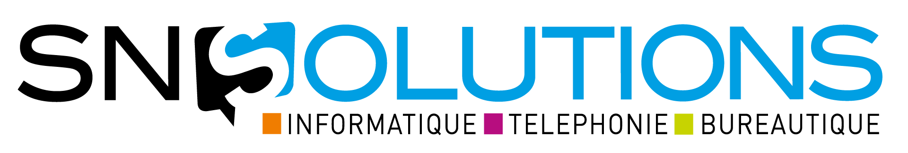

# Rapport de Stage

*Stage effectué chez SNS Solutions à Toulouse*



**Nills Maillet**  
25/06/2026  
SLAM - BTS SIO1

---

## Sommaire

- [1. Introduction](#1-introduction)
  - [1.1. Présentation du stage](#11-présentation-du-stage)
  - [1.2. Objectifs du rapport](#12-objectifs-du-rapport)
- [2. Présentation de l'entreprise](#2-présentation-de-lentreprise)
  - [2.1. Historique et activité de SNS SOLUTIONS](#21-historique-et-activité-de-sns-solutions)
  - [2.2. Organisation générale de l'entreprise](#22-organisation-générale-de-lentreprise)
  - [2.3. Place du stage dans l'entreprise](#23-place-du-stage-dans-lentreprise)
- [3. Environnement technique et outils utilisés](#3-environnement-technique-et-outils-utilisés)
  - [3.1. Outils de gestion et de support](#31-outils-de-gestion-et-de-support)
  - [3.2. Outils d'infrastructure et de sécurité](#32-outils-dinfrastructure-et-de-sécurité)
  - [3.3. Outils de communication et de collaboration](#33-outils-de-communication-et-de-collaboration)
- [4. Déroulé du stage](#4-déroulé-du-stage)
  - [4.1. Semaine du 26 mai](#41-semaine-du-26-mai)
  - [4.2. Semaine du 1er juin](#42-semaine-du-1er-juin)
  - [4.3. Semaine du 8 juin](#43-semaine-du-8-juin)
  - [4.4. Semaine du 15 juin](#44-semaine-du-15-juin)
  - [4.5. Semaine du 22 juin](#45-semaine-du-22-juin)
- [5. Missions principales réalisées](#5-missions-principales-réalisées)
  - [5.1. Migration d'un contrôleur UniFi](#51-migration-dun-contrôleur-unifi)
  - [5.2. Mise en place d'un Serveur MDT](#52-mise-en-place-dun-serveur-mdt)
- [6. Compétences acquises](#6-compétences-acquises)
  - [6.1. Compétences techniques](#61-compétences-techniques)
  - [6.2. Compétences méthodologiques](#62-compétences-méthodologiques)
- [7. Bilan personnel et conclusion](#7-bilan-personnel-et-conclusion)
  - [7.1. Apports du stage](#71-apports-du-stage)
  - [7.2. Difficultés rencontrées](#72-difficultés-rencontrées)
  - [7.3. Liens avec mon parcours et conclusion](#73-liens-avec-mon-parcours-et-conclusion)
- [8. Annexes](#8-annexes)
  - [8.1. Fichier compose.yaml](#81-fichier-composeyaml)

---

## 1. Introduction

### 1.1. Présentation du stage

Dans le cadre de la première année du BTS SIO, j’ai effectué un stage en entreprise d'une durée de 5 semaines. Ce stage s'est déroulé du 25 mai au 26 juin 2026 au sein de l'agence de Toulouse de la société SNS SOLUTIONS. Cette immersion en milieu professionnel constitue une étape clé de ma formation, me permettant de confronter mes connaissances théoriques aux réalités et exigences d'une structure spécialisée dans l'infogérance.

### 1.2. Objectifs du rapport

Ce rapport a pour but de synthétiser les activités réalisées et les compétences développées tout au long de cette période. Au-delà de la simple description chronologique des tâches, il s'agit de formaliser une analyse technique des solutions mises en œuvre pour répondre aux besoins spécifiques des clients de SNS SOLUTIONS. Ce document vise également à évaluer l'apport de ce stage dans la construction de mon projet professionnel en tant que futur développeur et administrateur de solutions informatiques.

## 2. Présentation de l'entreprise

### 2.1. Historique et activité de SNS SOLUTIONS

Fondée en 2004, SNS SOLUTIONS est une société de services informatiques (ESN) spécialisée dans l'infogérance, l'intégration d'architectures réseaux, les télécoms et la cybersécurité. Positionnée comme une Direction des Systèmes d'Information (DSI) externalisée, l'entreprise s'adresse principalement aux Très Petites Entreprises (TPE) et Petites et Moyennes Entreprises (PME). Son cœur de métier consiste à auditer, concevoir, sécuriser et maintenir en condition opérationnelle les infrastructures informatiques de ses clients.

### 2.2. Organisation générale de l'entreprise

Pour garantir un service de proximité et une grande réactivité, SNS SOLUTIONS s'appuie sur un réseau national de cinq agences : Bordeaux, Marseille, Nice, Monaco et Toulouse, où j'ai effectué mon stage. L'entreprise conserve une structure à taille humaine, ce qui favorise l'agilité et la communication directe entre les équipes. L'organisation du travail y est généralement structurée par client : chaque technicien ou développeur prend en charge le suivi et les interventions d'un portefeuille de comptes de manière autonome, tout en collaborant sur les projets d'envergure.

### 2.3. Place du stage dans l'entreprise

J'ai été intégré au sein de l'équipe technique de l'agence de Toulouse, une équipe récemment constituée et en phase de montée en charge sur le périmètre des infrastructures locales. En tant que stagiaire informatique, mon rôle a été d'assister les collaborateurs dans la résolution des incidents de support, de participer aux audits de parc sur site, et de mener à bien des missions d'optimisation technique. Cette position transverse m'a permis d'étudier de près les flux de production d'une ESN et d'apporter mon support technique tout en découvrant les contraintes de sécurité liées au milieu professionnel.

## 3. Environnement technique et outils utilisés

### 3.1. Outils de gestion et de support

Cette catégorie regroupe les solutions indispensables au suivi des incidents (helpdesk), à la gestion de la maintenance et à la centralisation des connaissances techniques de l'entreprise.

| Solution / Logiciel | Nature / Descriptif | Rôle / Utilisation |
| --- | --- | --- |
| SNS SOLUTIONS GPI | Solution interne basée sur le noyau open-source GLPI. | Centralise la gestion des tickets d'incident, le suivi des projets clients et sert de base de connaissances principale. |
| Tactical RMM | Outil de Remote Monitoring & Management. | Assure l'inventaire automatisé du parc machine, la supervision en temps réel et la prise en main à distance (sans dépendance DNS). |
| SharePoint | Plateforme de gestion documentaire Microsoft. | Utilisée historiquement pour stocker les procédures et schémas d'infrastructure (en cours de migration vers GPI). |

### 3.2. Outils d'infrastructure et de sécurité

Ces technologies forment le socle technique permettant d'héberger les services applicatifs des clients, de virtualiser les serveurs et de garantir la sécurité périmétrique des réseaux.

| Solution / Logiciel | Nature / Descriptif | Rôle / Utilisation |
| --- | --- | --- |
| OVH Cloud | Fournisseur de services Cloud (IaaS/PaaS). | Hébergement distant et externalisé de certaines infrastructures et sauvegardes clients. |
| Proxmox VE | Hyperviseur de type 1 (Bare Metal). | Hébergement et gestion des machines virtuelles (VM) et conteneurs (LXC) au sein des infrastructures. |
| Microsoft Hyper-V | Solution de virtualisation intégrée à Windows Server. | Utilisée pour la gestion d'environnements virtualisés sous environnement Microsoft Windows. |
| StormShield Network Security | Solution de pare-feu (Firewall) matériel. | Assure la sécurité périmétrique des réseaux clients, le filtrage du trafic, la détection d'intrusions et la gestion des tunnels VPN. |
| ESET (EDR) | Solution antivirus. | Protection centralisée des postes de travail et serveurs contre les malwares et comportements suspects. |
| Draw.io | Outil de modélisation graphique. | Conception et mise à jour des schémas d'architecture réseau et des cartographies d'infrastructures. |

### 3.3. Outils de communication et de collaboration

Ces outils forment l'environnement de travail quotidien des collaborateurs de SNS SOLUTIONS et des clients, facilitant les échanges internes et la gestion des flux téléphoniques.

| Solution / Logiciel | Nature / Descriptif | Rôle / Utilisation |
| --- | --- | --- |
| Microsoft 356 Pro | Suite collaborative Cloud (Outlook, Teams, OneDrive). | Gestion quotidienne de la messagerie électronique corporative et des canaux de communication internes. |
| 3CX | Système d'IPBX logiciel (VoIP). | Plateforme de téléphonie d'entreprise gérant les appels internes, externes et l'installation de modules SBC chez les clients. |
| Unyc / Sewan | Opérateurs Télécoms de gros. | Fournisseurs de Trunk SIP assurant la connectivité et le routage des lignes VoIP vers le réseau public. |

## 4. Déroulé du stage

### 4.1. Semaine du 26 mai

Cette semaine d'intégration a débuté le mardi 26 mai par le diagnostic d'un ordinateur portable Dell Precision 3590 sujet à des crashs répétés (BSOD) lors de l'utilisation d'applications métiers lourdes. L'analyse de l'Observateur d'événements a révélé un conflit entre le micro-pilote constructeur `dtdsel.sys` et le gestionnaire de fichiers Windows (FilterManager, ID 11), survenant immédiatement avant des coupures recensées sous la source Kernel-Power (ID 41). Après m'être documenté en ligne sur le soucis et après avoir vérifié l'obsolescence du BIOS dans le Boot Loader, j'ai utilisé l'outil Dell SupportAssist fain de déployer 11 mises à jour critiques affectant les firmwares Intel, Dell, Nvidia ainsi que le BIOS lui-même, avant de placer le poste en phase d'examen tout en gardant l'hypothèse d'un défaut matériel de carte mère ou de RAM en piste secondaire. Cette solution semble avoir été un succès.

Le mercredi 27 mai a été consacré à l'observation de l'équipe et à la découverte du fonctionnement de celle-ci, une étape nécessaire en attendant la validation de mes accès de sécurité aux ressources internes.

Le jeudi 28 mai après-midi, j'ai pris en charge un contrôleur WiFi UniFi hébergé sur un Raspberry Pi client. Pour l'identifier sur le réseau isolé et dépourvu de service DHCP, j'ai configuré une IP statique sur mon poste afin de me placer sur le même sous-réseau, validant la connectivité par un scan `nmap` et une commande `ping`, bien que l'interface Web soit restée inaccessible et m'ait obligé à tenter une connexion SSH sans identifiants connus.

Le vendredi 29 mai, la consultation de la documentation sur GPI m'a permis d'obtenir ces identifiants pour me connecter en SSH et accéder à l'interface Webmin via un port d'écoute non standard. Le diagnostic ayant révélé un défaut d'alimentation rendant le matériel non fiable, la décision a été prise de remplacer le Raspberry Pi par un mini PC NIPOGI. Face à l'échec d'authentification sur le compte existant, suspecté d'être rattaché à un ancien domaine Active Directory, nous avons procédé à une réinitialisation complète du système d'exploitation pour préparer le terrain.

### 4.2. Semaine du 1er juin

Le lundi 1er juin, la configuration du mini PC NIPOGI a débuté par la création d'un compte local et l'installation du composant logiciel SBC 3CX pour sécuriser les flux VoIP du client. J'ai ensuite déployé l'environnement UniFi Network Server via Docker Desktop et WSL à l'aide de Docker Compose pour isoler l'application, validant l'accès sur le port 11443 (Cf. [8.1. Compose docker](#81-fichier-composeyaml)). L'importation de la sauvegarde a toutefois échoué car UniFi exigeait les identifiants du compte UI d'origine, dont la recherche a été lancée pendant que je traitais, en parallèle, un ticket d'assistance en anglais concernant un blocage d'authentification sur Microsoft Teams.

Le mardi 2 juin au matin, la découverte du compte Ubiquiti dans la base GPI a permis d'importer le fichier de configuration auvegardé `.unf` et de restaurer le contrôleur avant de finaliser son paramétrage réseau (IPv4, masque, passerelle et DNS public 8.8.8.8). L'après-midi, lors d'une intervention sur site pour remplacer la batterie d'un onduleur, nous avons constaté un défaut de redondance sur la baie serveur, l'ensemble des équipements étant branché exclusivement sur l'onduleur plutôt que d'être réparti avec le secteur direct. L'opération a été reportée en fin de semaine pour éviter une coupure de la production, et nous avons profité de notre présence pour archiver des messageries saturées sur des clients Outlook, localement ou via TeamViewer pour les salariés non présents sur site, tout en proposant à une cliente le déploiement futur d'un mode de concentration supprimant l'ensemble des notifications sur le bureau via GPO.

Le mercredi 3 juin a été dédié à un audit complet sur site afin de mettre à jour la base de connaissances interne. J'ai collecté les noms d'hôtes, les utilisateurs et les identifiants TeamViewer Host de chaque poste, tout en installant les agents de supervision Tactical RMM. En interrogeant directement les utilisateurs lors de cet audit sur leurs éventuels problèmes quotidiens, nous avons pu recenser des besoins spécifiques, notamment une couverture WiFi insuffisante dans une partie des locaux nécessitant l'installation d'une borne supplémentaire, ainsi que des besoins en équipements d'impression à certains postes de travail. J'ai également pu résoudre avec mon collègue des dysfonctionnements de scanners/imprimantes via la mise à jour ou l'installation de pilotes, contourner une panne DNS bloquant l'accès aux partages réseau en modifiant manuellement le fichier `hosts` local, activer le presse-papier pour les sessions RDP et recréer une passerelle manquante sur un poste. De retour à l'agence, j'ai testé les postes présents dans le stock afin de récupérer les informations nécessaires pour purger ces machines obsolètes de Tactical RMM. Enfin, j'ai nettoyé les profils des ordinateurs de prêt dans le dossier `C:\Users` et supprimé les clés de registre affiliées via `regedit`.

Le jeudi 4 juin, nous avons supprimé la fenêtre d'avertissement de sécurité RDP de Windows 11 en installant le rôle d'Autorité de Certification (CA) sur le serveur d'un client, générant un certificat SSL interne directement intégré au fichier de configuration `.rdp`. Nous avons ensuite créé la GPO de concentration demandée par la cliente, ce qui a nécessité la modification forcée des clés de registre "NoToastApplicationNotifications" et "NewMailDesktopAlerts" dans `HK_LOCAL_MACHINE` et `HK_CURRENT_USER` pour contourner l'échec des règles standards. La journée s'est poursuivie par la détection d'attaques régulières par bruteforce sur un serveur client, analysées via ADAuditPlus, l'Observateur d'événements et l'outil de scan Nessus Essentials, avant de terminer par une auto-formation sur PowerShell et le scripting pour maîtriser les cmdlets, le pipeline d'objets et les opérateurs `-like` et `-match` pour les expressions régulières regex.

Le vendredi 5 juin, la matinée a été consacrée à l'inventaire physique et technique rigoureux de l'ensemble du stock matériel de l'agence. Enfin, l'après-midi a permis de tester avec succès la GPO de concentration sur le poste de la cliente après l'exécution d'un `gpupdate` et d'un redémarrage, validant la solution pour un déploiement global sur sa flotte informatique.

### 4.3. Semaine du 8 juin

Le lundi 8 juin au matin, nous avons constaté un dysfonctionnement de la solution RDP mise en place la semaine précédente, les signatures des fichiers `.rdp` ayant disparu et bloquant l'utilisation du certificat d'origine. Pour y remédier, un nouveau certificat a été généré et la signature des fichiers a été effectuée via une version plus récente de l'utilitaire `rdpsign.exe` prenant en charge l'algorithme d'empreinte SHA-256 à la place de SHA-1, ce qui a nécessité l'exportation préalable du certificat avec sa clé privée au format `.pfx` vers une machine plus récente. L'obtention de la nouvelle empreinte SHA a été réalisée en ligne de commande via PowerShell avec la syntaxe `Get-ChildItem Cert:\CurrentUser\My`, et sa validation en console avec la commande `rdpsign.exe /sha256 EMPREINTE /v "CHEMIN_DU_FICHIER.rdp"` avant la mise à jour de la GPO éditeur. La matinée s'est conclue par la prise en charge d'un ticket concernant un poste privé d'accès au WiFi de l'entreprise, le problème persistant malgré la configuration manuelle de sa passerelle par défaut. L'après-midi a été consacrée à l'observation de la gestion des tickets, débutant par un diagnostic sur le serveur d'un client où une imprimante réseau ne remontait pas lors des scans d'équipements actifs, obligeant à mettre le ticket en attente. Enfin, nous avons configuré à distance une connexion VPN sur un poste macOS en récupérant le fichier de configuration `.ovpn` depuis l'application web de Stormshield Network Security (SNS) pour l'importer dans le client OpenVPN.

Le mardi 9 juin, la journée a été entièrement dédiée à de l'observation passive et active au sein de l'agence afin de suivre les techniciens dans la réception, la qualification et le traitement de la file d'attente des tickets de support quotidien. Cette session m'a permis d'appréhender la diversité des incidents, de comprendre les priorités d'attribution selon leur urgence et d'assimiler les postures de relation client lors des résolutions téléphoniques. J'ai également mis à profit cette journée pour formaliser une proposition d'offre commerciale concernant la création d'un site vitrine pour un client, pour lequel j'ai préconisé l'utilisation du CMS WordPress associé au constructeur de page Elementor.

Le mercredi 10 juin au matin, j'ai pris en charge la gestion des Déchets d'Équipements Électriques et Électroniques (DEEE) du stock de l'agence en suivant la procédure interne de tri, de rangement et de préparation logistique, conclue par un inventaire photographique et l'envoi d'un courriel officiel à l'organisme de recyclage agréé. L'après-midi a permis de résoudre un incident critique d'échec de sauvegardes externalisées, le NAS de destination hébergé dans la baie technique de notre agence ayant été retrouvé éteint. Après son redémarrage manuel, nous nous sommes connectés à l'interface d'administration du NAS source du client afin de valider la bonne visibilité de l'équipement distant via l'outil propriétaire Hyper Backup de Synology, relançant ainsi les réplications de données.

Le jeudi 11 juin a été marqué par l'obtention définitive de mes identifiants professionnels et de mon adresse électronique, me donnant un accès complet à la suite Microsoft Office ainsi qu'à l'application de helpdesk interne SNS Solutions GPI. J'ai immédiatement exploité ces accès en traitant un ticket de sécurité visant à prémunir plusieurs infrastructures clients contre des vulnérabilités critiques ; ma mission consistant à rechercher les URL et identifiants dans la documentation technique, à me connecter sur chaque instance de l'IPBX 3CX et à initier les mises à jour de firmware depuis l'onglet d'administration système. La journée s'est terminée par une maintenance logicielle sur un poste ancien pour réparer une installation corrompue d'un pack Microsoft Office Home and Student 2007.

Le vendredi 12 juin, j'ai pris en charge un ticket concernant l'échec d'une sauvegarde sur l'outil Veeam Backup & Replication, dont le diagnostic a révélé une saturation complète du disque de la machine virtuelle Veeam, ouvrant la piste d'une extension de l'allocation de son volume de stockage. Un second ticket lié à des dossiers Outlook s'affichant anormalement en anglais sur un compte IMAP a été traité, avec pour piste technique le renommage des dossiers par défaut directement côté serveur via le webmail Roundcube d'OVHcloud, restant en attente de validation avec l'utilisateur. Enfin, un dernier incident de sauvegarde impossible vers notre NAS d'agence a été analysé : suspectant des coupures intermittentes de notre boîtier OTB (OverTheBox), j'ai vérifié l'état du service local puis je me suis connecté à la machine virtuelle Hyper-V hébergeant BackupAssist Classic chez le client afin de forcer l'exécution d'une nouvelle tâche de sauvegarde pour tester la stabilité de la liaison réseau. Il conviendra de vérifier, en début de semaine prochaine, si cette dernière sauvegarde s'est bien effectuée à son terme.

### 4.4. Semaine du 15 juin

Le lundi 15 juin, j'ai procédé au remplacement matériel de la batterie d'un ordinateur portable Dell Latitude 3410, passant d'un modèle 3 cellules (40Wh) à un modèle 4 cellules (53Wh) après ouverture du châssis, déconnexion de l'ancienne batterie et fixation du nouveau bloc. J'ai ensuite vérifié une backup sur le serveur d'un client : celle-ci s'étant accomplie sans erreur, j'ai pu clôturer le ticket, ainsi qu'un second ticket de sauvegarde réseau historique désormais opérationnel. L'après-midi a été dédiée au diagnostic de deux échecs de sauvegarde System State sur la plateforme Cove Data Protection. Sur le premier serveur, le tableau de bord indiquait l'erreur « Failed to get drive layout: The request failed due to a fatal device hardware error ». Après prise en main du serveur, j'ai exécuté un `chkdsk C:` qui n'a détecté aucun secteur défectueux, tandis que l'outil Intel Rapid Storage Technology affichait un état Healthy. L'analyse de l'Observateur d'événements Windows a toutefois révélé des erreurs Disk ID 154 répétées quotidiennement hors plages de sauvegarde, confirmant la piste d'un disque physique défectueux. Sur le second ticket, la prise en main de la machine virtuelle a révélé ces mêmes erreurs ID 154 dans les journaux Windows ; le volume H: restait accessible via l'explorateur, mais Cove Backup Manager bloquait sur l'erreur « Unable to list directory H:...\storage\cabs » pour cause d'erreur matérielle grave, orientant le diagnostic vers la nécessité de déplacer la machine virtuelle existante vers un nouveau disque de stockage non endommagé matériellement.

Le mardi 16 juin au matin, j'ai procédé à la préparation de plusieurs ordinateurs portables Terra pour un client. Après l'installation physique des batteries et un état des lieux du système d'exploitation pré-installé, j'ai déployé la suite logicielle standard (TeamViewer Host, Adobe Acrobat Reader, Eset, Mozilla Firefox, Google Chrome) ainsi que l'agent de supervision Tactical RMM, avant de valider leur bonne remontée sur nos consoles de gestion respectives et de lancer l'ensemble des mises à jour Windows Update. L'après-midi a été consacrée à une intervention sur site chez un client pour réaliser le nettoyage technique de son stock, incluant le test des équipements réseau en réserve, le tri des composants fonctionnels et la collecte d'une partie des Déchets d'Équipements Électriques et Électroniques (DEEE).

Le mercredi 17 juin au matin, j'ai finalisé les dernières configurations et validations sur les ordinateurs portables Terra. L'après-midi a marqué le début d'un projet d'infrastructure visant à déployer un hyperviseur Proxmox VE et un serveur de déploiement MDT (Microsoft Deployment Toolkit). Pour ce faire, nous avons récupéré un serveur Dell PowerEdge R710 afin d'en faire l'état des lieux physique et logique ; l'analyse matérielle a révélé l'absence d'un ventilateur châssis provoquant une surventilation de sécurité ainsi que deux disques non détectés, tandis que l'audit du disque contenait une instance Windows Server 2019 vierge. Après raccordement au réseau, j'ai accédé à la carte de gestion distante iDRAC pour appliquer une mise à jour de son firmware, bien que l'accumulation des défaillances matérielles matérielles réserve l'usage en production de ce châssis.

Le jeudi 18 juin a débuté par des tâches de support interne en matinée. L'après-midi a été dédiée à la configuration d'ordinateurs portables clients, impliquant la création des sessions utilisateur locales, l'installation et l'initialisation du client VPN FortiClient pour sécuriser les futurs accès distants, ainsi que le provisionnement et la configuration des profils de messagerie sur Microsoft Outlook.

Le vendredi 19 juin au matin, j'ai traité un ticket d'incident concernant un dysfonctionnement de la fonctionnalité Scan-to-Mail sur une imprimante réseau. Le diagnostic a révélé que le poste client était connecté à un VPN, l'isolant du sous-réseau local de l'imprimante ; une fois le tunnel désactivé, j'ai identifié l'adresse IP de l'équipement via un balayage avec Advanced IP Scanner pour me connecter à son interface Web d'administration. J'y ai reconfiguré les adresses de destination et d'émission, puis rectifié les paramètres du serveur de messagerie sortant (SMTP) en renseignant le serveur de messagerie du client, l'identifiant et le mot de passe requis pour l'authentification des scans. L'après-midi, dans la continuité du projet d'infrastructure Proxmox/MDT, nous avons récupéré un second serveur pour remplacer le châssis défaillant de mercredi. Après avoir constaté que son système Windows Server d'origine ne contenait aucune donnée critique, j'ai tenté de configurer son interface de gestion iDRAC6. Bien que l'adresse IP statique attribuée répondît positivement au ping, la connexion à l'interface Web a échoué malgré l'abaissement des restrictions de sécurité de mon navigateur Firefox pour accepter les anciens protocoles TLS, conduisant à l'abandon de l'iDRAC au profit d'une installation ultérieure en local.

### 4.5. Semaine du 22 juin

Le lundi 22 juin, dans le cadre du projet de déploiement d'un hyperviseur, j'ai sauvegardé les données d'un disque SSD externe avant d'utiliser l'utilitaire Rufus pour créer un support d'installation bootable contenant l'image ISO de Proxmox VE destiné à un serveur Dell PowerEdge R510. J'ai ensuite préparé un poste informatique de prêt via le nettoyage des clés de registre des anciens profils utilisateurs et l'application des mises à jour système, avant de finaliser le paramétrage de deux ordinateurs portables Terra impliquant la création des sessions locales, l'installation du client VPN FortiClient et le provisionnement des profils Microsoft Outlook.

Le mardi 23 juin, la matinée a débuté par la finalisation du dernier ordinateur portable Terra. J'ai ensuite procédé à l'installation en local et à la configuration initiale de Proxmox VE sur le serveur PowerEdge, en définissant son nom de domaine pleinement qualifié (FQDN), son adresse IP statique et son masque de sous-réseau, avant de paramétrer les dépôts de paquets système (repositories) pour contourner l'absence de souscription payante. Constatant que plusieurs disques physiques n'étaient pas détectés par l'hyperviseur, le diagnostic a révélé qu'ils n'étaient pas rattachés à un disque virtuel RAID ; nous avons donc remplacé les unités défectueuses, puis accédé à l'utilitaire du contrôleur de stockage PERC dans le BIOS afin de configurer un nouveau volume virtuel logique viable.

Le mercredi 24 juin, j'ai traité un ticket concernant une boucle d'authentification sur une boîte de messagerie Microsoft Exchange depuis un iPad client ; l'accès au service étant pleinement fonctionnel via le Webmail, la piste d'un mot de passe erroné a été écartée. N'ayant pas pu résoudre l'incident à distance, j'ai escaladé le ticket à un collègue afin qu'il puisse planifier un rendez-vous physique directement avec l'agence de Marseille. L'après-midi a été consacrée à la configuration du serveur MDT (Microsoft Deployment Toolkit) virtualisé sous Proxmox : j'ai procédé à la mise à jour du partage de déploiement (Deployment Share), généré les images de boot `.wim` et `.iso` LiteTouch, puis injecté un système d'exploitation de référence associé à une séquence de tâches personnalisée afin d'initier un premier test de déploiement sur une machine virtuelle témoin via le montage direct du fichier ISO.

Le jeudi 25 juin, j'ai finalisé la mise en production du serveur de déploiement MDT en validant avec succès un test d'amorçage réseau PXE (Pre-boot eXecution Environment) sur un poste physique connecté au même segment de réseau. L'infrastructure locale est désormais opérationnelle et configurée, restant en attente de la réception du dossier Deployment Share de notre agence de Marseille afin d'importer l'intégralité de leurs images d'exploitation (masters) et de leurs séquences de tâches standardisées.

(- Prise en charge en après-midi d'un ticket lié à une utilisatrice n'ayant pas accès au partage d'un dossier particulier)

Le vendredi 26 juin,

## 5. Missions principales réalisées

### 5.1. Migration d'un contrôleur UniFi

#### 5.1.1. Contexte et problématique

Dans le cadre de la maintenance des infrastructures d’un client externe, nous avons dû intervenir sur un contrôleur UniFi (Ubiquiti) hébergé sur un Raspberry Pi physiquement instable en raison d'un défaut récurrent d'alimentation électrique. Ce contrôleur est critique car il centralise la configuration, le routage et la supervision de l'ensemble des bornes WiFi de l'entreprise cliente. L'objectif de la mission consistait à auditer l'ancien équipement, extraire ses données de configuration, et migrer le service vers un mini PC NIPOGI de remplacement en isolant l'application dans un environnement conteneurisé.

#### 5.1.2. Audit de l'existant et extraction des données

Pour mener à bien cette migration sans coupure de production pour les utilisateurs, l'ancien matériel défaillant a été isolé sur un switch de laboratoire connecté à mon poste de travail. En l'absence de serveur DHCP sur ce segment réseau, j'ai configuré une adresse IPv4 statique sur ma machine pour me positionner sur le même sous-réseau logique.

Un balayage réseau via `nmap` combiné à une commande `ping` a validé la connectivité IP, bien que l'interface de gestion Web standard restait inaccessible à cause d'un blocage des services HTTP/S locaux. Après l'extraction des identifiants d'administration dans l'outil de helpdesk interne SNS Solutions GPI, j'ai établi une liaison SSH depuis mon terminal afin de rebondir sur l'interface d'administration système Webmin, accessible via un port d'écoute non standard. Cette manipulation a permis de sauvegarder l'intégralité de la configuration du contrôleur sous la forme d'un fichier compressé `.unf`.

#### 5.1.3. Préparation de la nouvelle plateforme (SBC et Docker)

Le mini PC de remplacement NIPOGI a d'abord subi une réinitialisation d'usine complète de son système d'exploitation Windows afin de purger les anciens comptes d'un domaine Active Directory devenu obsolète. Un profil administrateur local a été créé pour stabiliser l'environnement de travail.

Afin de centraliser les services réseau du client, j'ai procédé à l'installation du composant logiciel SBC 3CX (Session Border Controller) dédié à la sécurisation des flux de téléphonie VoIP en frontière de réseau.

Ensuite, pour garantir la portabilité et simplifier la maintenance future du contrôleur WiFi, j'ai implémenté l'environnement UniFi Network Server au sein de conteneurs isolés. J'ai configuré Docker Desktop adossé au sous-système Linux WSL (Windows Subsystem for Linux), puis j'ai rédigé et déployé le fichier d'orchestration `compose.yaml` (Cf. [8.1. Fichier compose.yaml](#81-fichier-composeyaml)).

L'initialisation, le rafraîchissement des dépendances et le lancement en arrière-plan de l'infrastructure logicielle ont été exécutés en ligne de commande via la suite d'instructions suivantes :

```bash
docker compose up -d
docker compose down
docker compose pull
docker compose up -d
```

À l'issue de cette phase, l'accès à la nouvelle interface Web a été validé avec succès sur le port personnalisé 11443.

#### 5.1.4. Restauration de la configuration et mise en production

La phase finale consistait à réimporter le fichier de sauvegarde `.unf` extrait du Raspberry Pi. Une restriction de sécurité du constructeur Ubiquiti a initialement bloqué l'opération, exigeant les privilèges du compte cloud UI d'origine. Après des recherches approfondies dans l'historique documentaire de notre application de gestion GPI, les clés d'authentification du compte propriétaire ont été récupérées, permettant de finaliser la restauration complète des configurations de zones et de la topologie réseau.

Le mini PC a enfin été raccordé à l’infrastructure de production du client. En nous basant sur les schémas réseaux de l'entreprise, nous avons fixé son adressage réseau statique : injection de l'adresse IPv4 fixe, application du masque de sous-réseau, routage vers la passerelle par défaut et renseignement des serveurs DNS publics (8.8.8.8). Cette intervention garantit désormais au client un serveur de supervision stable, virtualisé et facilement sauvegardable.

### 5.2. Mise en place d'un Serveur MDT

#### 5.2.1. Contexte et problématique

Dans le cadre de l’activité de l’agence, la préparation de nouveaux postes clients et le reconditionnement de flottes informatiques d'envergure étaient des tâches chronophages lorsqu'elles étaient effectuées manuellement ou de manière isolée. Afin de standardiser les systèmes d'exploitation, de garantir la conformité des configurations logicielles et de rationaliser le temps technique, le déploiement d'une infrastructure d'industrialisation est apparu indispensable. La mise en place de la solution MDT (Microsoft Deployment Toolkit) répond à ce besoin en offrant un environnement centralisé pour le déploiement automatisé d'images système (masters) standardisées.

#### 5.2.2. Récupération d'un serveur Dell PowerEdge R510

Le projet a débuté par le recyclage d'un serveur physique Dell PowerEdge R510. L’audit logique initial de la machine n'a révélé aucune donnée ou rôle critique en production, validant sa réaffectation. J'ai configuré ses paramètres d'interface réseau (adresse IP statique, masque de sous-réseau et passerelle par défaut). Une tentative de configuration et d'accès à la carte de gestion distante iDRAC6 a été menée afin d'assurer un monitoring hors-bande ; cependant, l'interface Web est restée inaccessible malgré la validation des pings réseau, suggérant un composant défectueux ou l’absence d'un micrologiciel Web embarqué sur cette génération récursive, ce qui nous a conduits à abandonner cette option pour administrer le serveur localement.

#### 5.2.3. Installation et configuration de Proxmox VE

Afin d'optimiser l'allocation des ressources matérielles, nous avons choisi d'héberger la solution sur l'hyperviseur de type 1 Proxmox VE. Pour l'installation, j’ai sauvegardé un disque SSD externe avant d'utiliser l'utilitaire Rufus pour y flasher l'image ISO de Proxmox et le rendre bootable. Après un accès au BIOS du serveur pour valider l'activation des options de virtualisation matérielle (Intel VT-x), j'ai configuré l'ordre d'amorçage pour démarrer sur le support USB et finaliser l'installation de l'OS.

Une fois l’interface de gestion Web accessible, j'ai modifié le fichier des sources de paquets (`/etc/apt/sources.list.d/pve-enterprise.list`) afin de désactiver les dépôts soumis à souscription payante au profit du dépôt libre `pve-no-subscription`, permettant ainsi l'exécution des commandes de mise à jour `apt update && apt upgrade -y`. Au niveau du stockage, plusieurs disques physiques n'apparaissaient pas dans l'interface graphique. L’investigation a révélé qu'ils n'étaient soit pas détectés physiquement, soit non rattachés à un volume RAID logique. Nous avons procédé au remplacement des disques défaillants, puis accédé à l'utilitaire du contrôleur de stockage PERC au démarrage du serveur afin de créer un nouveau disque virtuel (Virtual Disk) comprenant ces unités, le rendant instantanément disponible pour le stockage de l'hyperviseur.

#### 5.2.4. Installation et configuration de Windows Server 2022

Une fois l'environnement de virtualisation configuré, j'ai téléchargé l'image ISO de Windows Server 2022 et créé une machine virtuelle (VM) dédiée sous Proxmox. Lors de la phase post-installation du système d'exploitation Microsoft, j'ai appliqué une configuration réseau statique cohérente avec le plan d'adressage de l'agence pour garantir la joignabilité permanente des futurs services de déploiement.

#### 5.2.5. Installation de ADK, WinPE, MDT et WDS

Le déploiement par MDT repose sur l'articulation de plusieurs composants logiciels interdépendants que j'ai installés et configurés sur la machine virtuelle. En premier lieu, Windows ADK (Assessment and Deployment Kit) fournit les outils fondamentaux de personnalisation des images Windows, tandis que son module complémentaire WinPE permet de générer l'environnement de préinstallation minimaliste destiné à s'exécuter dans la mémoire vive des postes clients. La console MDT (Microsoft Deployment Toolkit) centralise quant à elle la structure du partage de déploiement (Deployment Share), gère l'importation des systèmes d'exploitation ainsi que les pilotes, et orchestre les séquences de tâches (Task Sequences) automatisées. Enfin, le rôle de serveur WDS (Windows Deployment Services) a été configuré pour écouter les requêtes d'amorçage réseau et acheminer l'image de démarrage légère (LiteTouch au format `.wim`) vers les machines cibles. En attente de recevoir la configuration de référence de l'agence de Marseille, j'ai initialisé un Deployment Share local de test, importé une image système générique et créé une séquence de tâches d'installation basique afin de valider la génération des fichiers ISO et WIM.

#### 5.2.6. Essai de déploiement via PXE

Pour valider l’infrastructure, un test d'intégration a été réalisé à l'aide d'un ordinateur portable Dell raccordé physiquement au commutateur réseau de notre commutateur de test. En forçant le démarrage du poste client en mode PXE Boot, la carte réseau a correctement intercepté la diffusion DHCP, contacté le rôle WDS de notre serveur Windows, et téléchargé l'environnement de boot LiteTouch généré par MDT. Le chargement de l'assistant de déploiement a confirmé le succès opérationnel de la chaîne de liaison.

#### 5.2.7. Import de la configuration de l'agence de Marseille

La dernière étape consiste à importer le dossier Deployment Share consolidé par l'agence de Marseille. Cette intégration permettra d'unifier les pratiques des deux sites en récupérant l'intégralité des configurations d'applications, des pilotes matériels spécifiques et des séquences de tâches avancées afin de déployer des postes rigoureusement identiques à la charte technique globale de l'entreprise.

## 6. Compétences acquises

### 6.1. Compétences techniques

- **Administration système et gestion des politiques d'environnement** : Déploiement et modification de stratégies de groupe (GPO) sous Active Directory, avec édition forcée des bases de registres Windows (HKLM / HKCU) pour contourner les limitations des modèles standards. Création, signature et intégration de certificats SSL via le rôle d'Autorité de Certification (CA) pour sécuriser les flux de connexion RDP.
- **Virtualisation et conteneurisation** : Déploiement d'applications réseau conteneurisées à l'aide de Docker Desktop, WSL (Windows Subsystem for Linux) et l'outil d'orchestration Docker Compose (`compose.yaml`).
- **Diagnostic et maintenance de parc** : Analyse avancée des journaux d'erreurs Windows (Observateur d'événements) pour la résolution de crashs critiques (codes ID 11 FilterManager et ID 41 Kernel-Power). Utilisation d'outils de helpdesk, d'inventaire et de gestion de correctifs constructeurs (Dell SupportAssist).
- **Réseaux et gestion des infrastructures** : Configuration, sauvegarde et restauration de contrôleurs de bornes WiFi (UniFi Network Server via fichiers de configuration `.unf`). Paramétrage réseau IPv4 (adresses statiques, masques, passerelles, DNS) et gestion des protocoles d'administration à distance (SSH, RDP, serveurs Webmin).
- **Sécurité et supervision informatique** : Détection et analyse de tentatives d'intrusions par force brute via la corrélation de journaux (ADAuditPlus). Utilisation de scanners de vulnérabilités réseau (Nessus Essentials) et d'agents de supervision à distance (Tactical RMM).
- **Scripting et automatisation** : Auto-formation sur l'environnement de script PowerShell (`.ps1`), manipulation de pipelines d'objets, utilisation des cmdlets standards et filtrage de données textuelles complexes via expressions régulières (opérateur `-match`).

### 6.2. Compétences méthodologiques

- **Audit de parc et recueil du besoin** : Conduite d'audits techniques directement sur site client. Capacité à interroger les utilisateurs finaux pour identifier les dysfonctionnements quotidiens et enrichir la base de connaissances interne de l'entreprise.
- **Gestion de la relation client et support** : Assistance technique à distance (TeamViewer) doublée d'un accompagnement pédagogique par téléphone pour autonomiser les utilisateurs. Prise en charge et traitement de tickets d'incident dans un contexte international (support technique géré en langue anglaise).
- **Rigueur organisationnelle et logistique** : Gestion, test physique, qualification et inventaire technique d'un stock matériel informatique de niveau agence. Nettoyage et reconditionnement logiciel rigoureux (profils et registres) du matériel destiné au prêt.
- **Planification et gestion des risques** : Évaluation des risques d'interruption de production lors d'interventions critiques sur site (détection d'un défaut de redondance sur une baie serveur) et négociation de reports d'interventions sur des plages horaires à impact minimal pour l'activité du client.

## 7. Bilan personnel et conclusion

### 7.1. Apports du stage

Bien que mon parcours d'origine au sein du BTS SIO soit spécialisé en développement (option SLAM), ce stage m'a apporté une expérience terrain considérable dans un domaine qui n'est pas ma spécialité première. Travailler au sein d'une infrastructure d'infogérance m'a permis d'acquérir de solides compétences pratiques et opérationnelles. Cette immersion m'a donné l'opportunité de manipuler des technologies réseaux et systèmes que je n'avais pas l'habitude de côtoyer, élargissant ainsi ma culture informatique globale et ma vision technique des environnements d'entreprise.

### 7.2. Difficultés rencontrées

Le principal défi de cette expérience a résidé dans la confrontation directe avec la réalité d'une Entreprise de Services du Numérique (ESN). N'ayant pas l'habitude de gérer un flux continu de tickets d'incident très variés, j'ai dû m'adapter rapidement à des domaines où je ne possédais aucune expérience préalable, tels que la téléphonie sur IP (softphones), la gestion des serveurs de messagerie (webmail), le suivi des sauvegardes critiques ou la configuration de périphériques réseau (imprimantes et scanners). De plus, l'utilisation d'outils de supervision et de helpdesk qui m'étaient totalement inconnus a nécessité un effort d'apprentissage rapide. Enfin, développer une communication immédiate, claire et efficace avec les clients lors des résolutions techniques a constitué un apprentissage exigeant mais indispensable.

### 7.3. Liens avec mon parcours et conclusion

Malgré mon orientation native vers la programmation et le développement logiciel, ce stage s'est révélé être une opportunité hautement formatrice et nécessaire. Mon ambition professionnelle étant de devenir ingénieur, je reste convaincu que même en se spécialisant dans le développement ou dans la cybersécurité, posséder de solides bases en administration systèmes, en gestion de réseaux et en infogérance est un atout indispensable. Un bon ingénieur doit comprendre l'infrastructure sur laquelle reposent ses programmes. Ce stage m'a permis de décloisonner mes compétences et confirme ma volonté de poursuivre mes études vers un cycle d'ingénieur avec un profil technique complet et polyvalent.

## 8. Annexes

### 8.1. Fichier compose.yaml

Contenu du fichier `compose.yaml` :

```yaml
services:
  unifi-os-server:
    image: ghcr.io/lemker/unifi-os-server:latest
    container_name: unifi-os-server
    privileged: true
    environment:
      - UOS_SYSTEM_IP=10.0.10.3
    volumes:
      - unifi-os-server_persistent:/persistent
      - unifi-os-server_var-log:/var/log
      - unifi-os-server_data:/data
      - unifi-os-server_srv:/srv
      - unifi-os-server_var-lib-unifi:/var/lib/unifi
      - unifi-os-server_var-lib-mongodb:/var/lib/mongodb
      - unifi-os-server_etc-rabbitmq-ssl:/etc/rabbitmq/ssl
    ports:
      - 11443:443
      - 5005:5005
      - 9543:9543
      - 6789:6789
      - 8080:8080
      - 8443:8443
      - 8444:8444
      - 3478:3478/udp
      - 5514:5514/udp
      - 10003:10003/udp
      - 11084:11084
      - 5671:5671
      - 8880:8880
      - 8881:8881
      - 8882:8882
    restart: unless-stopped

volumes:
  unifi-os-server_persistent:
  unifi-os-server_var-log:
  unifi-os-server_data:
  unifi-os-server_srv:
  unifi-os-server_var-lib-unifi:
  unifi-os-server_var-lib-mongodb:
  unifi-os-server_etc-rabbitmq-ssl:
```
